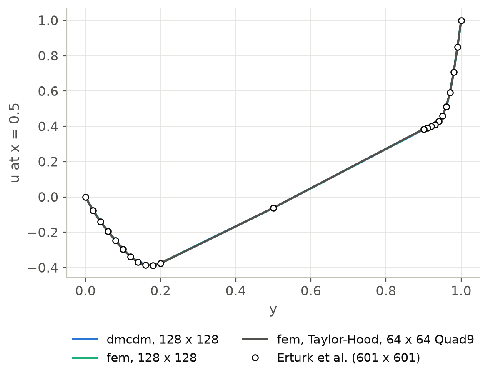
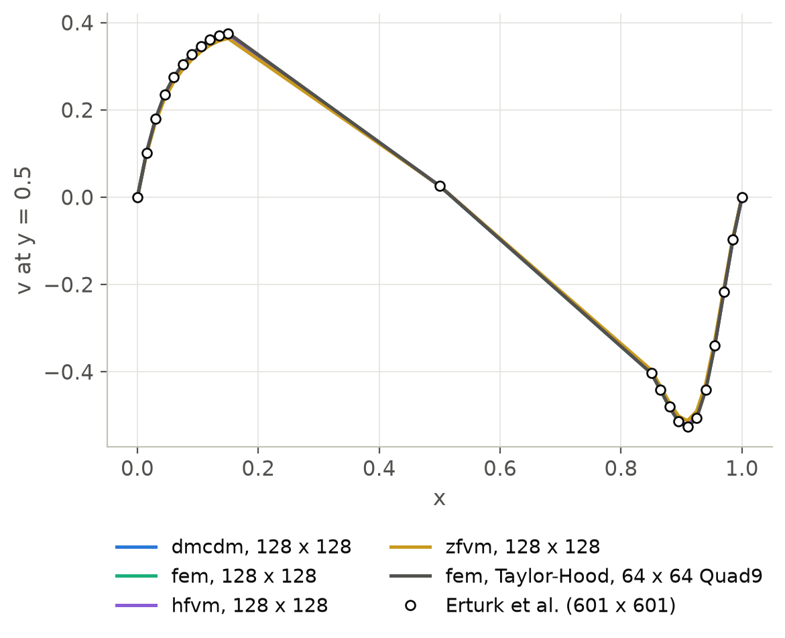
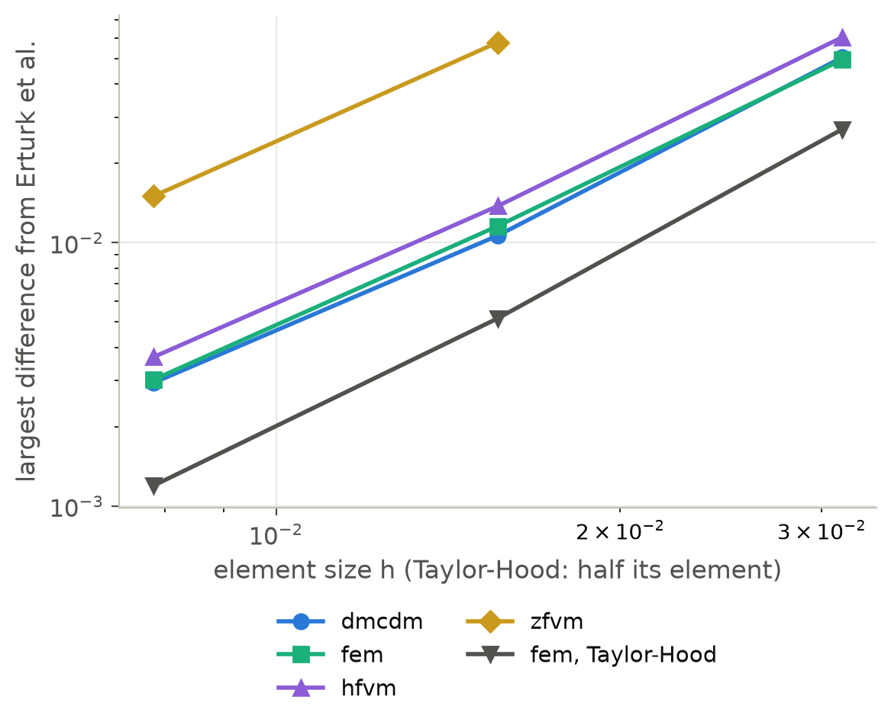

F5: Lid-driven cavity at Re = 1000
===================================

The problem
-----------

The unit square is filled with a fluid whose top side, the lid, slides at the
speed 1 and whose other sides are at rest.  With the density :math:`Re = 1000`
and the viscosity 1 the Reynolds number is 1000.  The steady flow is one large
vortex with two smaller ones in the lower corners.  Erturk, Corke and
Gokcol [Erturk2005]_ solved it on a :math:`601 \times 601` grid to residuals below
:math:`10^{-10}` and tabulated the velocity :math:`u` along the vertical
centerline :math:`x = 0.5` and :math:`v` along the horizontal centerline
:math:`y = 0.5` (their Tables 6 and 7).  Every method is compared with these 23
values of each profile on uniform meshes of :math:`n \times n` ``Quad4``
elements, by the largest difference.

The setup
---------

.. code-block:: python

   import numpy as np
   import dualmesh as dm

   mesh = dm.generate_rectangle_mesh(0, 1, 0, 1, 128, 128)
   problem = dm.Problem(mesh, method="DMCDM")  # or FEM
   flow = problem.add_physics(
       "fluid_dynamics",
       dynamic_viscosity=1.0,
       density=1000.0,
       formulation="pressure",
   )
   flow.add_boundary_condition(["velocity_x = 1", "velocity_y = 0"], boundary="top", scale_with_load=True)
   # added last, so that the top corners belong to the walls
   flow.add_boundary_condition(["velocity_x = 0", "velocity_y = 0"], boundary=["left", "right", "bottom"])
   problem.solve(load_factors=list(np.linspace(0.1, 1.0, 10)))

Newton's method reaches the steady state with the lid speed raised in ten load
steps.  The Taylor-Hood element takes ``formulation="Taylor-Hood"`` on ``Quad9``
elements, half as many per side.  The projection time integration
(``time_integration="projection"``) marches the flow from rest on the
:math:`64 \times 64` mesh at a Courant number of one half until the velocity
changes by less than :math:`10^{-7}` per unit time, which it does by
:math:`t = 150`.

Results
-------

.. list-table:: Largest difference from the centerline velocities of
   [Erturk2005]_ (Taylor-Hood: :math:`n/2 \times n/2` ``Quad9`` elements)
   :header-rows: 1
   :widths: 30 14 14 14 14 14

   * - Method
     - :math:`u`, :math:`n = 32`
     - :math:`u`, 64
     - :math:`u`, 128
     - :math:`v`, 64
     - :math:`v`, 128
   * - DMCDM
     - 0.0382
     - 0.0091
     - 0.0020
     - 0.0106
     - 0.0029
   * - FEM
     - 0.0348
     - 0.0078
     - 0.0015
     - 0.0116
     - 0.0030
   * - FEM, Taylor-Hood
     - 0.0251
     - 0.0052
     - 0.0012
     - 0.0042
     - 0.0011
   * - DMCDM, projection
     -
     - 0.0164
     -
     - 0.0167
     -
   * - FEM, projection
     -
     - 0.0082
     -
     - 0.0128
     -

Both methods converge to the reference at second order: the
difference falls by a factor of 3.6 to 5.0 from :math:`n = 32` to 64 and from 64
to 128, and is below 0.004 on the :math:`128 \times 128` mesh.  The quadratic
velocity of the Taylor-Hood element is 1.3 to 2.3 times closer on the same
number of nodes.  The differences of the stabilized methods are about half of
those before the parameter :math:`\tau` took the factor 9 on its viscous term
(:doc:`../theory/heat_and_fluids`): DMCDM had 0.0741, 0.0198 and 0.0062.

The projection time integration reaches a steady state about as close to the
reference as the monolithic solution for the finite element method, and farther
for the two methods of the dual mesh.  The monolithic solves carry the
streamline stabilization of the advection, and the splitting has none: at the
cell Reynolds number of about 16 of the :math:`64 \times 64` mesh, the methods of
the dual mesh need it more than the finite element method.

   The velocity :math:`u` along the vertical centerline.

   The velocity :math:`v` along the horizontal centerline.

   The largest difference from [Erturk2005]_ against the element size.

Reproducing the results
-----------------------

.. code-block:: console

   python verification/benchmarks/fluids/run_cavity.py              # about 8 minutes
   python verification/benchmarks/fluids/run_cavity.py --plot-only  # the figures only
