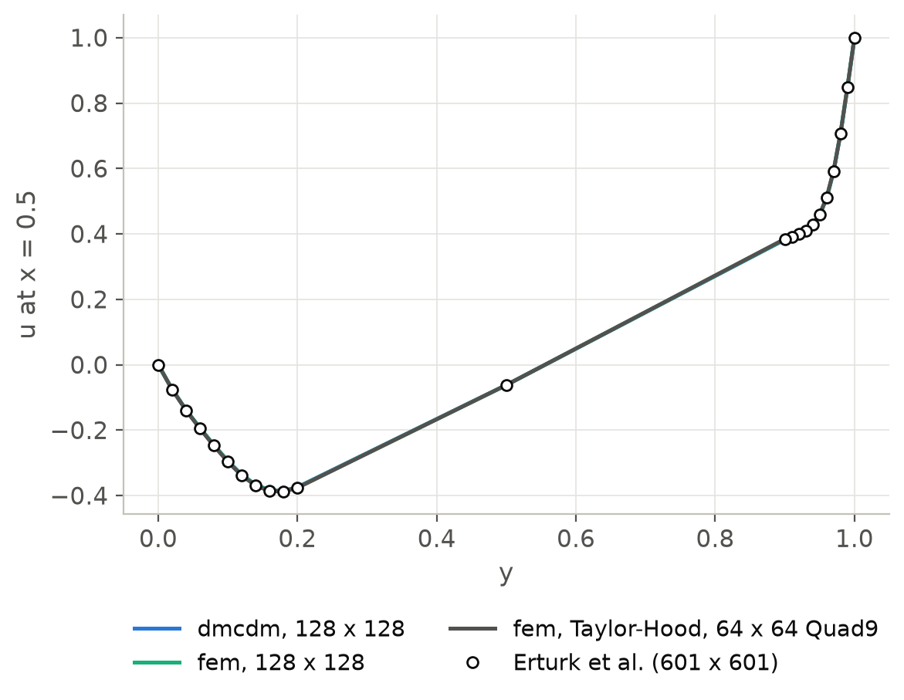
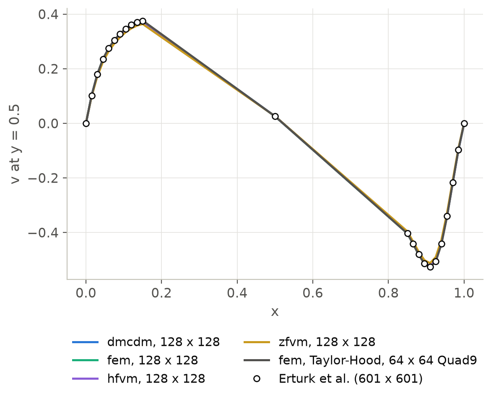
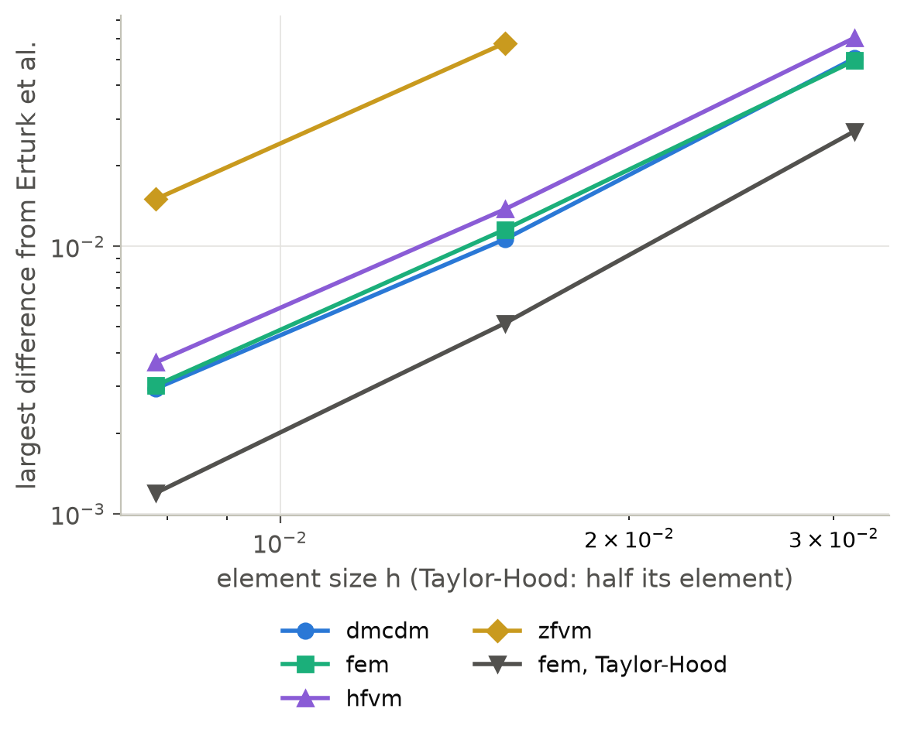

Lid-driven cavity at Re = 1000
==============================

This page compares the centerline velocities of the lid-driven cavity with the
fine-grid solution of Erturk, Corke and Gokcol [Erturk2005]_.  It uses the
finite element method (FEM) and the dual mesh control domain method (DMCDM).

The problem
-----------

The unit square holds a fluid whose top side, the lid, slides at the speed 1,
while the other sides are at rest.  With the density :math:`\rho = 1000` and
the dynamic viscosity :math:`\mu = 1`, the Reynolds number
:math:`Re = \rho U L / \mu`, with the lid speed :math:`U` and the side
:math:`L`, is 1000.  The steady flow is one large vortex with two smaller ones
in the lower corners.  [Erturk2005]_ solved it on a :math:`601 \times 601` grid
and tabulated the velocity :math:`v_x` along the vertical centerline
:math:`x = 0.5` and :math:`v_y` along the horizontal centerline
:math:`y = 0.5` (their Tables 6 and 7).  Every method is compared with these
23 values of each profile, by the largest difference, on uniform meshes of
:math:`n \times n` ``Quad4`` elements.

The setup
---------

.. code-block:: python

   import dualmesh

   mesh = dualmesh.generate_rectangle_mesh(0, 1, 0, 1, 128, 128)
   problem = dualmesh.Problem(mesh, method="DMCDM")  # Or "FEM"
   flow = problem.add_physics(
       "fluid_dynamics",
       dynamic_viscosity=1.0,
       density=1000.0,
       formulation="equal_order",
   )
   flow.add_boundary_condition(["velocity_x = 1", "velocity_y = 0"], boundary="top")
   # Added last, so that the two top corners belong to the walls
   flow.add_boundary_condition(["velocity_x = 0", "velocity_y = 0"], boundary=["left", "right", "bottom"])
   problem.solve()

Where Newton's method does not converge from the Stokes start, the solve
raises the lid speed from rest in steps.  The Taylor-Hood element, with a
quadratic velocity and a linear pressure, takes ``formulation="Taylor-Hood"``
and FEM on ``Quad9`` elements, half as many per side.  The projection time
integration (``time_integration="projection"``) marches the flow from rest on
the :math:`64 \times 64` mesh, with each time step set by the Courant number 0.5 (the distance the flow
travels in a step over the element size), until the velocity changes by less than :math:`10^{-7}` per unit time.
It reaches that state by :math:`t = 150` with FEM and :math:`t = 160` with
DMCDM.

Results
-------

.. list-table:: Largest difference from the centerline velocities of
   [Erturk2005]_ (Taylor-Hood: :math:`n/2 \times n/2` ``Quad9`` elements)
   :header-rows: 1
   :widths: 30 14 14 14 14 14

   * - Method
     - :math:`v_x`, :math:`n = 32`
     - :math:`v_x`, 64
     - :math:`v_x`, 128
     - :math:`v_y`, 64
     - :math:`v_y`, 128
   * - DMCDM
     - 0.0382
     - 0.0091
     - 0.0020
     - 0.0106
     - 0.0029
   * - FEM
     - 0.0348
     - 0.0078
     - 0.0015
     - 0.0116
     - 0.0030
   * - FEM, Taylor-Hood
     - 0.0251
     - 0.0052
     - 0.0012
     - 0.0042
     - 0.0011
   * - DMCDM, projection
     -
     - 0.0164
     -
     - 0.0167
     -
   * - FEM, projection
     -
     - 0.0082
     -
     - 0.0128
     -

Both methods converge to the reference at second order.  The difference falls
by a factor of 3.6 to 5.0 each time :math:`n` doubles, and it is below 0.004 on
the :math:`128 \times 128` mesh.  On the same nodes, the Taylor-Hood element
is 1.3 to 1.8 times closer in :math:`v_x` and 2.5 to 2.8 times closer in
:math:`v_y` than the equal-order elements.  On the :math:`64 \times 64` mesh,
the difference of the projection time integration exceeds the difference of
the steady solve by 5 to 10 % with FEM and by a factor of 1.6 to 1.8 with
DMCDM.

   Velocity :math:`v_x` along the vertical centerline on the finest mesh of
   every method, with the values of [Erturk2005]_ as circles.

   Velocity :math:`v_y` along the horizontal centerline on the finest mesh of
   every method, with the values of [Erturk2005]_ as circles.

   Largest difference from [Erturk2005]_ in either velocity against the
   element size :math:`h`.  For the Taylor-Hood element, :math:`h` is half
   its element.

Reproduce the results
---------------------

1. Run the script:

   .. code-block:: console

      python verification/benchmarks/fluids/run_cavity.py

2. Redraw the figures from the cache:

   .. code-block:: console

      python verification/benchmarks/fluids/run_cavity.py --plot-only
