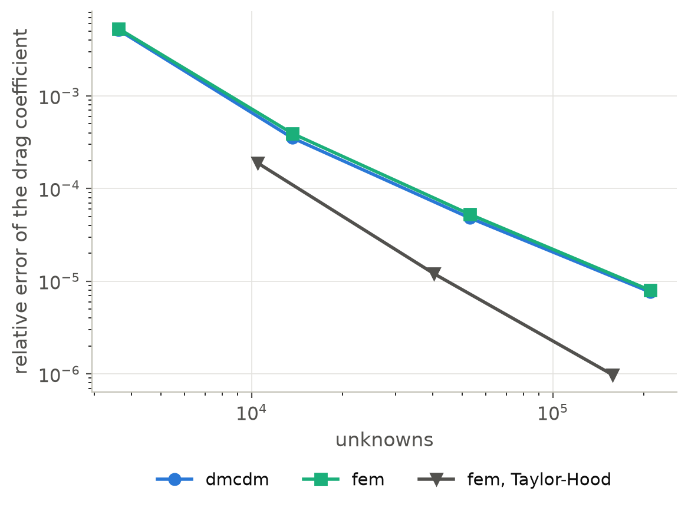
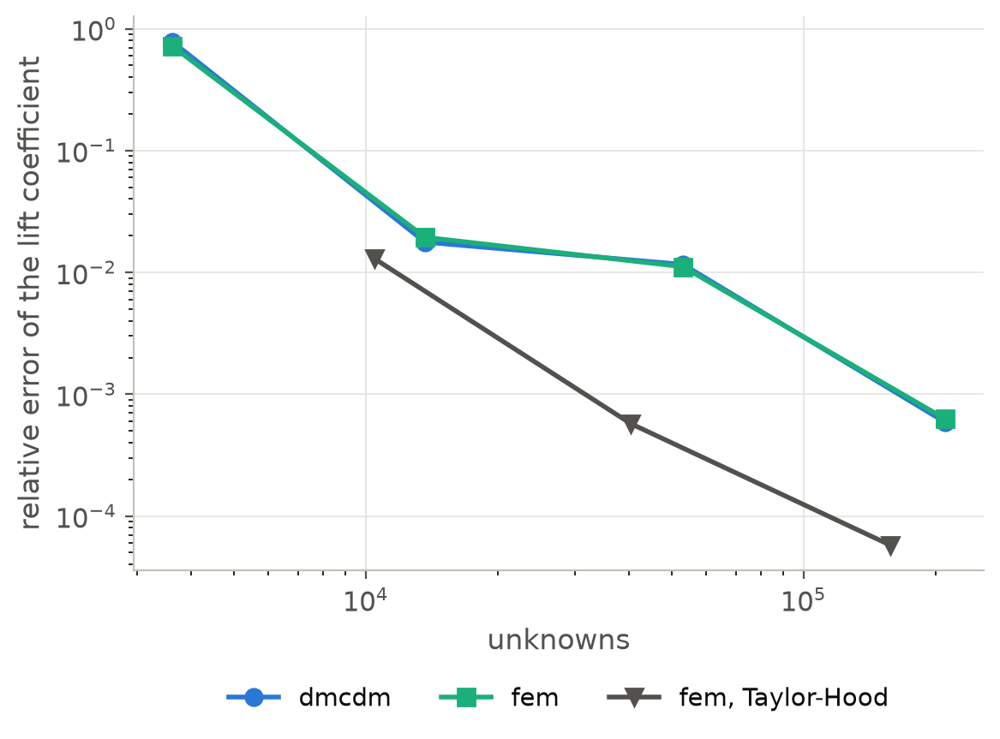
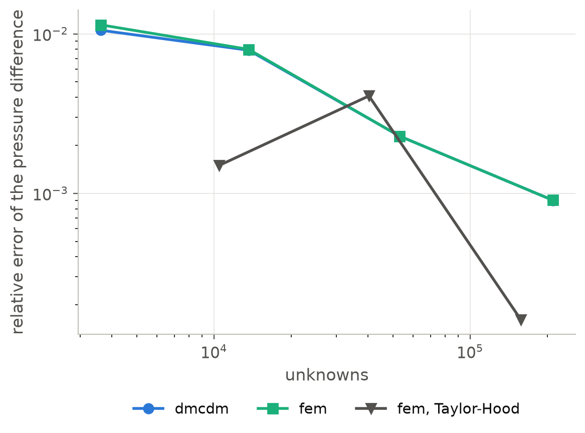

Flow around a cylinder, steady (DFG 2D-1)
=========================================

This page compares the drag, the lift and the pressure difference of a steady
flow around a cylinder with the reference values of the benchmark 2D-1 of the
German Research Foundation (DFG) [SchaeferTurek1996]_.  It uses the finite
element method (FEM) and the dual mesh control domain method (DMCDM).

The problem
-----------

A cylinder of diameter :math:`D = 0.1`, centred at :math:`(0.2, 0.2)`, sits in
the channel :math:`(0, 2.2) \times (0, 0.41)`, slightly below its axis, so that
the flow around it is not symmetric and the cylinder carries a small lift.  The
inflow is the parabola :math:`v_x = 4 U y (0.41 - y) / 0.41^2` with
:math:`U = 0.3`, where :math:`v_x` is the velocity along the channel and
:math:`y` the height.  The walls and the cylinder hold the fluid at rest.  The
outflow :math:`x = 2.2` carries the do-nothing condition
:math:`\mu\, \partial \mathbf{v} / \partial n - p \mathbf{n} = 0`, with
:math:`\mathbf{v}` the velocity, :math:`p` the pressure and :math:`\mu` the
dynamic viscosity.

The density is :math:`\rho = 1` and the viscosity :math:`\mu = 0.001`.  The
mean inflow velocity is :math:`\bar{U} = 2U/3 = 0.2`, so the Reynolds number
:math:`Re = \rho \bar{U} D / \mu` is 20, and the flow is steady.  The benchmark
asks for the drag and lift coefficients :math:`C = 2F / (\rho \bar{U}^2 D)` of
the force :math:`F` on the cylinder along :math:`x` and :math:`y`, and for the
pressure difference :math:`\Delta p = p(0.15, 0.2) - p(0.25, 0.2)` between the
front and the back of the cylinder.  The reference values of the FEATFLOW
benchmark pages are :math:`C_D = 5.57953523384`, :math:`C_L = 0.010618948146`
and :math:`\Delta p = 0.11752016697`.

The setup
---------

Gmsh [Gmsh2009]_ meshes the channel in triangles, graded from the size
:math:`h` on the cylinder to :math:`4h` at the distance 0.3 from it, with
:math:`h = 0.01`, 0.005, 0.0025 and 0.00125.  The function ``build`` of
``verification/benchmarks/fluids/dfg_mesh.py`` writes the mesh with the side
sets ``inlet``, ``outlet``, ``walls`` and ``cylinder``.  The Laplacian form of
the viscous term makes the do-nothing condition the natural condition, so the
outflow needs no condition.  ``flow.force`` gives the force of the fluid on the
cylinder from the reactions of its prescribed velocities.  Run from the root of
the repository, with Gmsh installed (``pip install gmsh``):

.. code-block:: python

   import sys

   import dualmesh

   sys.path.insert(0, "verification/benchmarks/fluids")
   import dfg_mesh

   mesh = dualmesh.read_mesh(str(dfg_mesh.build(0.005, "dfg.msh")))
   problem = dualmesh.Problem(mesh, method="DMCDM")  # Or "FEM"
   flow = problem.add_physics(
       "fluid_dynamics",
       density=1.0,
       dynamic_viscosity=1e-3,
       formulation="equal_order",
       viscous_form="laplacian",
   )
   flow.add_boundary_condition(
       ["velocity_x = 4*0.3*y*(0.41 - y)/0.41^2", "velocity_y = 0"], boundary="inlet"
   )
   flow.add_boundary_condition(["velocity_x = 0", "velocity_y = 0"], boundary=["walls", "cylinder"])
   problem.solve()
   force = flow.force("cylinder")
   drag = 2 / (0.2**2 * 0.1) * force["x"]
   lift = 2 / (0.2**2 * 0.1) * force["y"]
   p_front, p_back = problem.sample("pressure", [[0.15, 0.2], [0.25, 0.2]])

The equal-order formulation carries pressure stabilization.  The Taylor-Hood
element, with a quadratic velocity and a linear pressure, takes
``formulation="Taylor-Hood"`` and FEM on quadratic triangles twice as large
(``dfg_mesh.build(2 * h, path, order=2)``), whose sides on the cylinder lie on
the circle.

Results
-------

.. list-table:: The coefficients on the finest mesh of every method, and their
   relative errors
   :header-rows: 1
   :widths: 22 14 22 20 22

   * - Method
     - Unknowns
     - :math:`C_D`
     - :math:`C_L`
     - :math:`\Delta p`
   * - DMCDM
     - 210 429
     - 5.57958 (+0.0008 %)
     - 0.010613 (-0.06 %)
     - 0.11741 (-0.091 %)
   * - FEM
     - 210 429
     - 5.57958 (+0.0008 %)
     - 0.010612 (-0.06 %)
     - 0.11741 (-0.091 %)
   * - FEM, Taylor-Hood
     - 157 743
     - 5.57953 (-0.0001 %)
     - 0.010620 (+0.006 %)
     - 0.11750 (-0.016 %)
   * - Reference
     -
     - 5.57954
     - 0.010619
     - 0.11752

Every quantity converges to the reference.  For DMCDM the error of the drag
falls from 0.51 % on the coarsest mesh to 0.035 %, 0.0048 % and 0.0008 % as
:math:`h` is halved.  The lift is a hundredth of the drag and the difference of
two nearly equal forces on the two sides of the cylinder.  It has the right
sign on every mesh and is within 0.06 % on the finest.  The error of the
pressure difference falls as 1.05 %, 0.79 %, 0.23 % and 0.091 %, between first
and second order.  On the finest mesh the two methods agree in the drag and the
pressure difference to five digits.  The Taylor-Hood element reaches the
reference drag within 0.0001 % on fewer unknowns.

   Relative error of the drag coefficient against the number of unknowns,
   for every method.

   Relative error of the lift coefficient against the number of unknowns,
   for every method.

   Relative error of the pressure difference against the number of unknowns,
   for every method.

Reproduce the results
---------------------

The script ``verification/benchmarks/fluids/run_dfg_steady.py`` solves every
method on every mesh and merges the results of its runs in its cache.

1. Install Gmsh:

   .. code-block:: console

      pip install gmsh

2. Run each method:

   .. code-block:: console

      python verification/benchmarks/fluids/run_dfg_steady.py --method dmcdm
      python verification/benchmarks/fluids/run_dfg_steady.py --method fem
      python verification/benchmarks/fluids/run_dfg_steady.py --method Taylor-Hood

3. Redraw the figures from the cache:

   .. code-block:: console

      python verification/benchmarks/fluids/run_dfg_steady.py --plot-only
