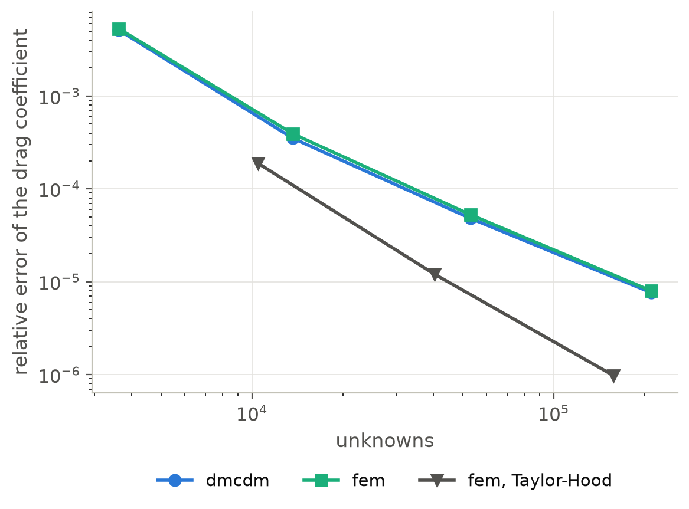
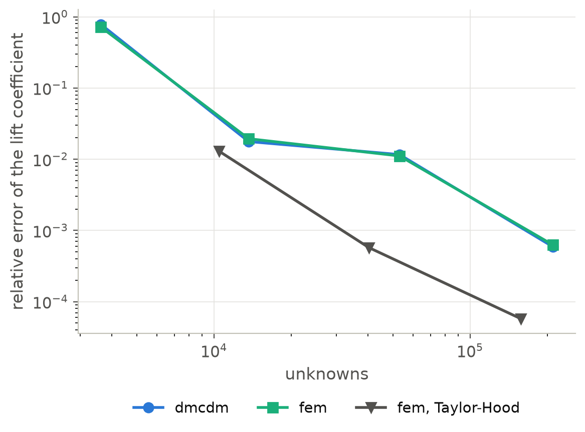
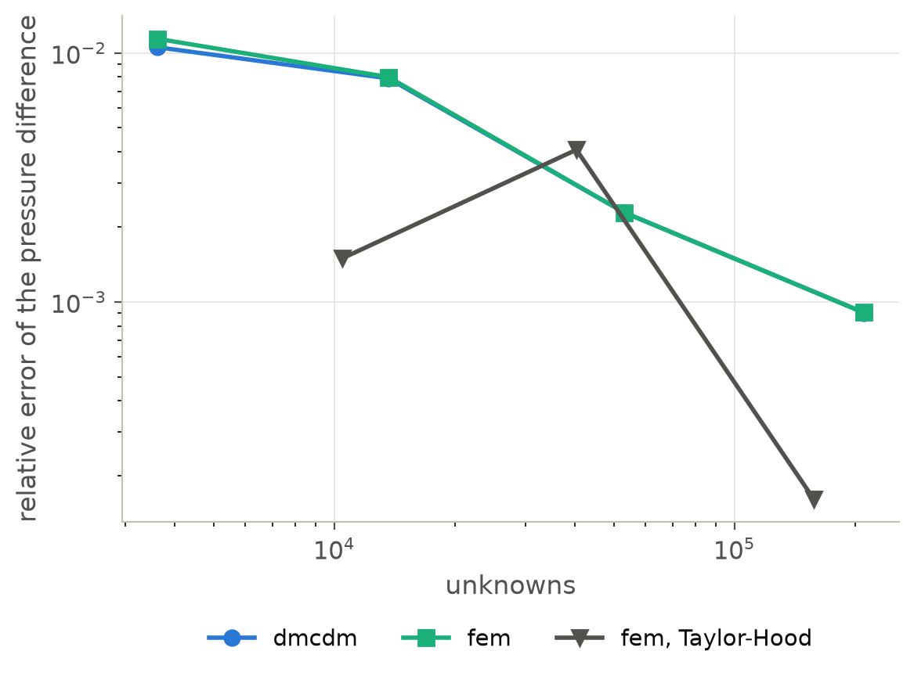

F1: Flow around a cylinder, steady (DFG 2D-1)
=============================================

The problem
-----------

The DFG benchmark of Schäfer and Turek [SchaeferTurek1996]_ places a cylinder
of diameter :math:`D = 0.1`, centered at :math:`(0.2, 0.2)`, in the channel
:math:`[0, 2.2] \times [0, 0.41]`, slightly below its axis, so that the flow
around it is not symmetric and the cylinder carries a small lift.  The inflow is
the parabola :math:`u = 4 U y (0.41 - y) / 0.41^2` with :math:`U = 0.3`, the
walls and the cylinder hold the fluid at rest, and the outflow :math:`x = 2.2`
is the do-nothing condition :math:`\nu\, \partial \mathbf{v} / \partial n - p
\mathbf{n} = 0`.  With the density 1 and the viscosity :math:`\nu = 0.001`, the
Reynolds number :math:`Re = \bar{U} D / \nu` is 20, with the mean velocity
:math:`\bar{U} = 2U/3 = 0.2`, and the flow is steady.  The benchmark asks for
the drag and lift coefficients :math:`C = 2F / (\bar{U}^2 D)` of the force
:math:`F` on the cylinder and for the pressure difference
:math:`\Delta p = p(0.15, 0.2) - p(0.25, 0.2)` between its front and its back.
The reference values of the FEATFLOW benchmark pages are
:math:`C_D = 5.57953523384`, :math:`C_L = 0.010618948146` and
:math:`\Delta p = 0.11752016697`.

The setup
---------

Gmsh meshes the channel in triangles, graded from the size :math:`h` on the
cylinder to :math:`4h` at the distance 0.3 from it
(``verification/benchmarks/fluids/dfg_mesh.py``), with
:math:`h = 0.01, 0.005, 0.0025, 0.00125`.  The Laplacian form of the viscous term
makes the do-nothing condition the natural one, so the outflow needs no
condition.  The force on the cylinder is minus the sum of the reactions of its
prescribed velocities:

.. code-block:: python

   import dualmesh as dm

   mesh = dm.read_mesh("dfg.msh")
   problem = dm.Problem(mesh, method="DMCDM")  # or FEM
   flow = problem.add_physics(
       "fluid_dynamics",
       density=1.0,
       dynamic_viscosity=1e-3,
       formulation="pressure",
       viscous_form="laplacian",
   )
   flow.add_boundary_condition(
       ["velocity_x = 4*0.3*y*(0.41 - y)/0.41^2", "velocity_y = 0"], boundary="inlet", scale_with_load=True
   )
   flow.add_boundary_condition(["velocity_x = 0", "velocity_y = 0"], boundary=["walls", "cylinder"])
   problem.solve()
   drag = -2 / (0.2**2 * 0.1) * problem.total_reaction("velocity_x", "cylinder")
   lift = -2 / (0.2**2 * 0.1) * problem.total_reaction("velocity_y", "cylinder")
   p_front, p_back = problem.sample("pressure", [[0.15, 0.2], [0.25, 0.2]])

The Taylor-Hood element takes ``formulation="Taylor-Hood"`` on quadratic
triangles twice as large, whose sides on the cylinder lie on the circle.

Results
-------

.. list-table:: The coefficients on the finest mesh of every method, and their
   relative errors
   :header-rows: 1
   :widths: 22 14 18 16 18

   * - Method
     - unknowns
     - :math:`C_D`
     - :math:`C_L`
     - :math:`\Delta p`
   * - DMCDM
     - 210 429
     - 5.57958 (+0.001 %)
     - 0.01061 (-0.1 %)
     - 0.11741 (-0.091 %)
   * - FEM
     - 210 429
     - 5.57958 (+0.001 %)
     - 0.01061 (-0.1 %)
     - 0.11741 (-0.091 %)
   * - FEM, Taylor-Hood
     - 157 743
     - 5.57953 (-0.000 %)
     - 0.01062 (+0.01 %)
     - 0.11750 (-0.016 %)
   * - Reference
     -
     - 5.57954
     - 0.010619
     - 0.117520

The drag of every method converges to the reference: for the equal-order
elements its error falls from 0.5 % on the coarsest mesh to 0.035 %, 0.005 % and
0.001 % as the element size is halved.  The lift, a hundredth of the drag and
the difference of two nearly equal forces on the two sides of the cylinder,
has the right sign on every mesh and is within 0.1 % on the finest.  The
pressure difference converges at between first and second order (errors of
1.05 %, 0.79 %, 0.23 % and 0.091 %), since the pressure of the stabilized
equal-order elements is first-order accurate at points.  On the finest mesh the
dual mesh control domain method agrees with the finite element method to every
printed digit.  These errors are about a fifth of
those measured before the parameter :math:`\tau` took the factor 9 on its
viscous term (:doc:`../theory/heat_and_fluids`): the drag error was 0.009 % and
that of the pressure difference 0.52 % on the finest mesh.  The Taylor-Hood element, with its curved sides on the cylinder
and its quadratic velocity, reproduces every printed digit of the reference
drag and lift on 158 000 unknowns.

   The relative error of the drag coefficient against the number of unknowns.

   The relative error of the lift coefficient against the number of unknowns.

   The relative error of the pressure difference against the number of unknowns.

Reproducing the results
-----------------------

.. code-block:: console

   pip install gmsh
   python verification/benchmarks/fluids/run_dfg_steady.py              # about 16 minutes
   python verification/benchmarks/fluids/run_dfg_steady.py --plot-only  # the figures only
