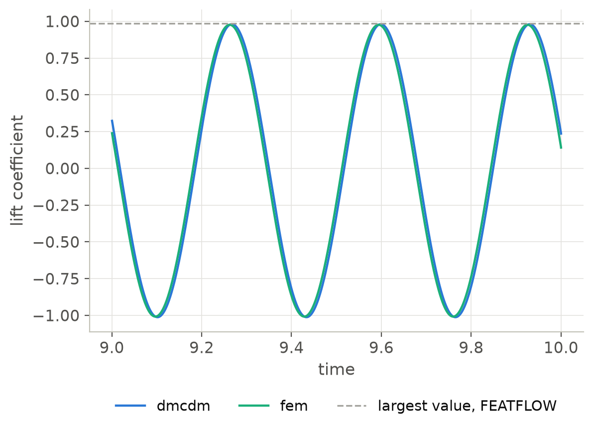
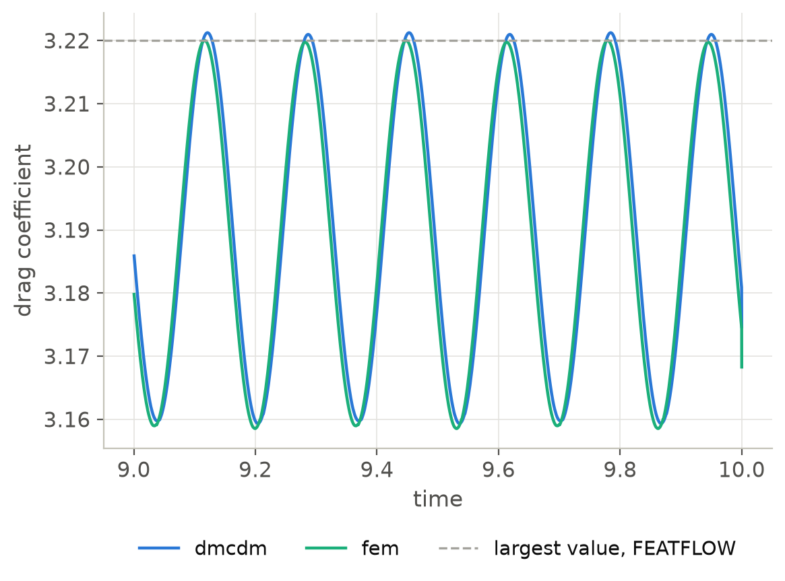

Flow around a cylinder, vortex shedding (DFG 2D-2)
==================================================

This page compares the oscillating drag and lift of the flow behind a cylinder
with the reference values of the benchmark 2D-2 of the German Research
Foundation (DFG) [SchaeferTurek1996]_.  It uses the finite element method
(FEM) and the dual mesh control domain method (DMCDM), with the projection time
integration.

The problem
-----------

The geometry and the boundary conditions are those of :doc:`dfg_steady`: a
cylinder of diameter :math:`D = 0.1` in the channel
:math:`(0, 2.2) \times (0, 0.41)`, the density :math:`\rho = 1` and the
dynamic viscosity :math:`\mu = 0.001`.  The inflow is
:math:`v_x = 4 U y (0.41 - y) / 0.41^2` with :math:`U = 1.5`, so the mean
inflow velocity is :math:`\bar{U} = 1` and the Reynolds number
:math:`Re = \rho \bar{U} D / \mu` is 100.  At this Reynolds number the wake is
unstable: vortices leave the two sides of the cylinder in turn, and the drag
and lift coefficients :math:`C_D` and :math:`C_L` oscillate with the frequency
:math:`f` of the shedding.  The benchmark asks for the largest :math:`C_D` and
:math:`C_L` of a cycle and for the Strouhal number :math:`St = D f / \bar{U}`.

The reference values of the FEATFLOW benchmark pages are
:math:`\max C_D = 3.2200`, :math:`\max C_L = 0.9859` and :math:`St = 0.30188`,
computed on level 6 of their meshes with the time step :math:`1/200`.

The setup
---------

The flow starts from rest.  The projection time integration advances it with
the backward difference formula and the extrapolation of second order (BDF2
and EXT2).  Each time step :math:`\Delta t` keeps the Courant number
:math:`C = \Delta t \max_e |\mathbf{v}| / h_e` at 0.5, with
:math:`\mathbf{v}` the velocity and :math:`h_e` the size of the element
:math:`e`.  The
projection takes the do-nothing outflow as the prescribed pressure
:math:`p = 0`, with the natural condition
:math:`\mu\, \partial \mathbf{v} / \partial n = 0` on the velocity.
``flow.force`` gives the force of the fluid on the cylinder at every step from
the reactions of its prescribed velocities.  The meshes are those of
:doc:`dfg_steady` with :math:`h = 0.005` and 0.0025.

.. code-block:: python

   import sys

   import dualmesh

   sys.path.insert(0, "verification/benchmarks/fluids")
   import dfg_mesh

   mesh = dualmesh.read_mesh(str(dfg_mesh.build(0.005, "dfg.msh")))
   problem = dualmesh.Problem(mesh, method="DMCDM")  # Or "FEM"
   flow = problem.add_physics(
       "fluid_dynamics",
       density=1.0,
       dynamic_viscosity=1e-3,
       formulation="equal_order",
       time_integration="projection",
   )
   flow.add_boundary_condition(["velocity_x = 4*1.5*y*(0.41 - y)/0.41^2", "velocity_y = 0"], boundary="inlet")
   flow.add_boundary_condition(["velocity_x = 0", "velocity_y = 0"], boundary=["walls", "cylinder"])
   flow.add_boundary_condition("pressure = 0", boundary="outlet")
   history = []

   def record(t, _problem):
       force = flow.force("cylinder")
       history.append((t, 20 * force["x"], 20 * force["y"]))  # 2 / (rho U^2 D) = 20

   problem.set_time_step_callback(record)
   problem.solve_transient(end_time=10.0, time_step=1e-3, time_stepper="cfl", courant_number=0.5)

The script measures the last three full cycles of the lift before
:math:`t = 10`, each from one minimum of the lift to the next.  They give the
period, and the largest :math:`C_D` and :math:`C_L` are taken over them.

Results
-------

.. list-table:: The largest drag and lift coefficients of a cycle and the
   Strouhal number, with their relative errors
   :header-rows: 1
   :widths: 20 16 22 22 20

   * - Method
     - Unknowns
     - :math:`\max C_D`
     - :math:`\max C_L`
     - :math:`St`
   * - FEM
     - 13 665
     - 3.2221 (+0.07 %)
     - 0.9618 (-2.44 %)
     - 0.30014 (-0.58 %)
   * - FEM
     - 53 049
     - 3.2200 (+0.00 %)
     - 0.9764 (-0.96 %)
     - 0.30170 (-0.06 %)
   * - DMCDM
     - 13 665
     - 3.2259 (+0.18 %)
     - 0.9763 (-0.98 %)
     - 0.29941 (-0.82 %)
   * - DMCDM
     - 53 049
     - 3.2212 (+0.04 %)
     - 0.9805 (-0.55 %)
     - 0.30156 (-0.10 %)
   * - Reference
     -
     - 3.2200
     - 0.9859
     - 0.30188

All three quantities converge to the reference.  Halving the element size
divides the error of the Strouhal number by 8 to 10 and the error of the
largest lift by 1.8 to 2.5.  On 53 049 unknowns the largest drag is within 0.04 %, the largest lift within 1 % and
the Strouhal number within 0.1 %.  The largest lift converges the slowest,
because it is the amplitude of the oscillation, which the numerical
dissipation of a coarse mesh damps.

   Lift coefficient from :math:`t = 9` to :math:`t = 10` on the finer mesh,
   with both methods, and the largest value of the reference as a dashed line.

   Drag coefficient from :math:`t = 9` to :math:`t = 10` on the finer mesh,
   with both methods, and the largest value of the reference as a dashed line.

Reproduce the results
---------------------

The script ``verification/benchmarks/fluids/run_dfg_unsteady.py`` runs both
meshes for each method and merges the results of its runs in its cache.

1. Install Gmsh:

   .. code-block:: console

      pip install gmsh

2. Run each method on several processes:

   .. code-block:: console

      mpirun -n 4 python verification/benchmarks/fluids/run_dfg_unsteady.py --method dmcdm
      mpirun -n 4 python verification/benchmarks/fluids/run_dfg_unsteady.py --method fem

3. Redraw the figures from the cache:

   .. code-block:: console

      python verification/benchmarks/fluids/run_dfg_unsteady.py --plot-only
