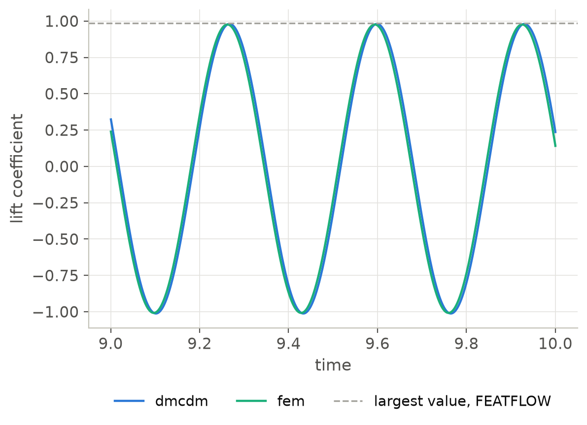
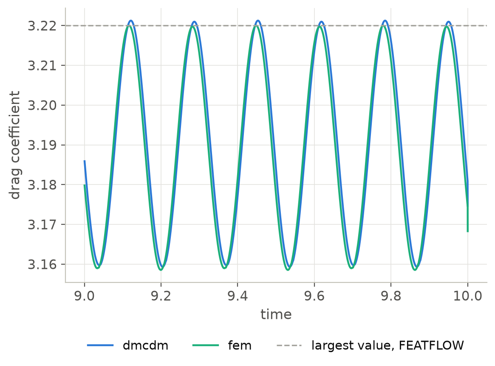

F2: Flow around a cylinder, vortex shedding (DFG 2D-2)
======================================================

The problem
-----------

The geometry and the boundary conditions are those of :doc:`dfg_steady`, with
the inflow :math:`u = 4 U y (0.41 - y) / 0.41^2` of :math:`U = 1.5`, so that the
mean velocity is :math:`\bar{U} = 1` and the Reynolds number
:math:`\bar{U} D / \nu = 100` [SchaeferTurek1996]_.  At this Reynolds number the
wake of the cylinder is unstable: vortices are shed from its two sides in turn,
and the drag and the lift oscillate with the frequency :math:`f` of the
shedding.  The benchmark asks for the largest drag and lift coefficients of a
cycle and for the Strouhal number :math:`St = D f / \bar{U}`.  The reference
values of the FEATFLOW benchmark pages, computed with :math:`Q_2/P_1^{disc}`
elements on 667 264 unknowns and the Crank-Nicolson method with the step
:math:`1/200`, are :math:`\max C_D = 3.2200`, :math:`\max C_L = 0.9859` and
:math:`St = 0.30188`.

The setup
---------

The flow starts from rest and is advanced by the projection time integration
(BDF2 and EXT2) at a Courant number of one half, distributed over two
processes.  The splitting takes the do-nothing outflow as a prescribed pressure
of zero, with the natural condition :math:`\nu\, \partial \mathbf{v} / \partial n
= 0` on the velocity.  The forces on the cylinder are minus the sums of the
reactions of its prescribed velocities, which the projection time integration
computes at every step from its momentum equations.

.. code-block:: python

   import dualmesh as dm

   mesh = dm.read_mesh("dfg.msh")
   problem = dm.Problem(mesh, method="DMCDM")  # or FEM
   flow = problem.add_physics(
       "fluid_dynamics",
       density=1.0,
       dynamic_viscosity=1e-3,
       formulation="pressure",
       time_integration="projection",
   )
   flow.add_boundary_condition(["velocity_x = 4*1.5*y*(0.41 - y)/0.41^2", "velocity_y = 0"], boundary="inlet")
   flow.add_boundary_condition(["velocity_x = 0", "velocity_y = 0"], boundary=["walls", "cylinder"])
   flow.add_boundary_condition("pressure = 0", boundary="outlet")
   forces = []
   problem.set_time_step_callback(
       lambda t, _: forces.append(
           (t, -20 * problem.total_reaction("velocity_x", "cylinder"), -20 * problem.total_reaction("velocity_y", "cylinder"))
       )
   )
   problem.solve_transient(end_time=10.0, time_step=1e-3, time_stepper="cfl", courant_number=0.5)

The shedding is periodic from about :math:`t = 7`.  The last three cycles before
:math:`t = 10`, each from one minimum of the lift to the next, give the period,
and the largest drag and lift coefficients are taken over them.

Results
-------

.. list-table:: The largest drag and lift coefficients of a cycle and the
   Strouhal number, with their relative errors, and the wall time of one step on
   two processes of a laptop
   :header-rows: 1
   :widths: 20 12 18 18 18 14

   * - Method
     - unknowns
     - :math:`\max C_D`
     - :math:`\max C_L`
     - :math:`St`
     - s per step
   * - FEM
     - 13 665
     - 3.2221 (+0.07 %)
     - 0.9618 (-2.44 %)
     - 0.30014 (-0.58 %)
     - 0.0053
   * - FEM
     - 53 049
     - 3.2200 (+0.00 %)
     - 0.9764 (-0.96 %)
     - 0.30170 (-0.06 %)
     - 0.025
   * - DMCDM
     - 13 665
     - 3.2259 (+0.18 %)
     - 0.9763 (-0.98 %)
     - 0.29941 (-0.82 %)
     - 0.0041
   * - DMCDM
     - 53 049
     - 3.2212 (+0.04 %)
     - 0.9805 (-0.55 %)
     - 0.30156 (-0.10 %)
     - 0.018
   * - Reference
     - 667 264
     - 3.2200
     - 0.9859
     - 0.30188
     -

All three quantities converge to the reference.  Halving the element size
divides the error of the Strouhal number by eight to ten and that of the largest
lift by about two, and brings the largest drag to within 0.04 %.  On 53 049
unknowns, a twelfth of those of the reference computation, the largest drag is
within 0.04 %, the largest lift within 1 % and the Strouhal number within
0.1 %.  The lift converges the slowest: it is the amplitude of the oscillation,
which the numerical dissipation of the coarse mesh damps.

The splitting caps the weight of the divergence in its pressure equation at
:math:`1/\tau`.  Against the numbers measured before the factor 9 entered the
viscous term of :math:`\tau` (24 October 2026), the error of the largest drag on
the coarser mesh fell from 2.3 to 2.5 % to 0.07 to 0.18 %, and that of the
Strouhal number fell by about half.  The error of the largest lift on the finer
mesh rose from 0.15 to 0.5 % to 0.55 to 1 %.

The steps of the dual mesh control domain method take 20 to 30 % less time
than those of the finite element method.
A step of the finer mesh takes 18 to 25 ms on two processes, and the run of ten
time units, about 19 000 steps at a Courant number of one half, takes five to
eight minutes.

   The lift coefficient over the last three cycles on the finer mesh.

   The drag coefficient over the last three cycles on the finer mesh.

Reproducing the results
-----------------------

.. code-block:: console

   pip install gmsh
   mpirun -n 2 python verification/benchmarks/fluids/run_dfg_unsteady.py --method dmcdm  # 6 to 9 minutes each
   mpirun -n 2 python verification/benchmarks/fluids/run_dfg_unsteady.py --method fem
   python verification/benchmarks/fluids/run_dfg_unsteady.py --plot-only
