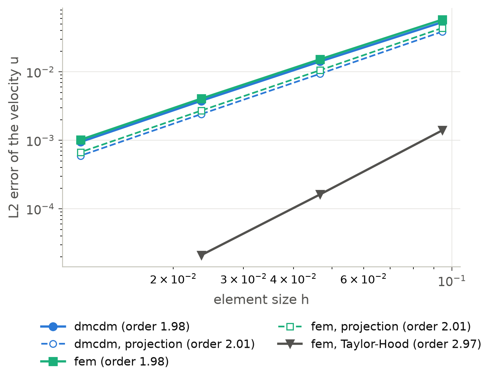
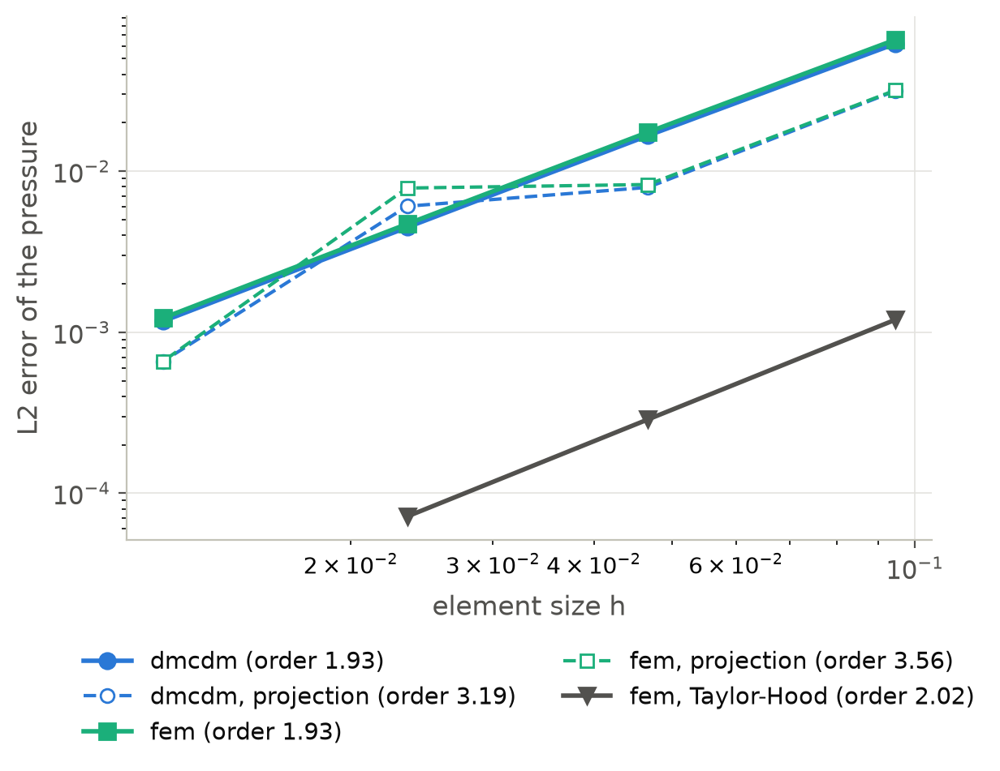

Kovasznay flow
==============

This page measures the error of every flow formulation against an exact
solution of the steady Navier-Stokes equations, the flow of Kovasznay
[Kovasznay1948]_.  It uses the finite element method (FEM) and the dual mesh
control domain method (DMCDM).

The problem
-----------

Kovasznay found the flow behind a row of cylinders in closed form.  With the
density :math:`\rho = 1` and the dynamic viscosity :math:`\mu = 1/Re`, at the
Reynolds number :math:`Re = 40`, the velocity :math:`\mathbf{v} = (v_x, v_y)`
and the pressure :math:`p`

.. math::

   v_x = 1 - e^{\zeta x} \cos 2\pi y , \qquad
   v_y = \frac{\zeta}{2\pi} e^{\zeta x} \sin 2\pi y , \qquad
   p = \tfrac{1}{2} \left( 1 - e^{2\zeta x} \right) , \qquad
   \zeta = \frac{Re}{2} - \sqrt{\frac{Re^2}{4} + 4\pi^2} ,

satisfy the steady Navier-Stokes equations without a body force, with
:math:`\zeta` the decay rate of the wake.  The script checks this
symbolically: the body force that would make the fields a solution is below
:math:`10^{-10}` at 200 points of the domain.  The domain
:math:`(-0.5, 1) \times (-0.5, 1.5)` holds one period in :math:`y` and the
decay of the wake in :math:`x`.  The meshes have :math:`n \times 4n/3`
``Quad4`` elements, rounded, with :math:`n = 16`, 32, 64 and 128.  The error is
measured in the :math:`L^2` norm.

The setup
---------

The steady solves prescribe the exact velocity on the left, bottom and top
sides and the exact traction on the outflow side :math:`x = 1`.
:class:`~dualmesh.mms.ManufacturedSolution` sets these conditions from the
exact fields and runs the convergence study:

.. code-block:: python

   import math

   import dualmesh
   from dualmesh import mms

   Re = 40.0
   zeta = Re / 2 - math.sqrt(Re**2 / 4 + 4 * math.pi**2)
   fields = {
       "velocity_x": f"1 - exp({zeta!r}*x)*cos(2*pi*y)",
       "velocity_y": f"{zeta / (2 * math.pi)!r}*exp({zeta!r}*x)*sin(2*pi*y)",
       "pressure": f"(1 - exp({2 * zeta!r}*x))/2",
   }
   study = mms.ManufacturedSolution(fields, dimension=2, flux_boundaries={"right": (1.0, 0.0)})
   study.add_physics(
       "fluid_dynamics",
       density=1.0,
       dynamic_viscosity=1.0 / Re,
       formulation="equal_order",  # Or "Taylor-Hood" on Quad9 elements with FEM
   )
   result = study.convergence_study(
       lambda n: dualmesh.generate_rectangle_mesh(-0.5, 1.0, -0.5, 1.5, n, round(4 * n / 3)),
       [16, 32, 64, 128],
       method="DMCDM",  # Or "FEM"
   )

The Taylor-Hood element, with a quadratic velocity and a linear pressure, runs
on ``Quad9`` elements with :math:`n = 16`, 32 and 64.

The projection time integration marches the flow from the exact fields to its
steady state, for ten time units, with each time step set by the Courant number 0.5 (the distance the flow travels in a step over the element size).  Its problem
prescribes the exact velocity on all four sides, because the projection
refuses a prescribed traction.  Its pressure is known up to a constant, so the script
compares it with the exact pressure shifted to the same mean.  The function
``projection_errors`` of the script holds this setup.

Results
-------

.. list-table:: Errors on the finest mesh, and orders between the two finest
   meshes (the Taylor-Hood element on :math:`64 \times 85` ``Quad9`` elements)
   :header-rows: 1
   :widths: 34 22 22

   * - Method
     - :math:`v_x`, :math:`L^2` (order)
     - :math:`p`, :math:`L^2` (order)
   * - DMCDM
     - :math:`9.48 \times 10^{-4}` (1.98)
     - :math:`1.17 \times 10^{-3}` (1.93)
   * - FEM
     - :math:`1.02 \times 10^{-3}` (1.98)
     - :math:`1.23 \times 10^{-3}` (1.93)
   * - FEM, Taylor-Hood
     - :math:`2.11 \times 10^{-5}` (2.97)
     - :math:`7.17 \times 10^{-5}` (2.02)
   * - DMCDM, projection
     - :math:`5.97 \times 10^{-4}` (2.01)
     - :math:`6.60 \times 10^{-4}` (3.19)
   * - FEM, projection
     - :math:`6.72 \times 10^{-4}` (2.01)
     - :math:`6.61 \times 10^{-4}` (3.56)

Every method converges to the exact solution at its expected order in the
velocity: second order for the equal-order elements and third order for the
quadratic velocity of the Taylor-Hood element.  The pressure of the steady
equal-order solutions converges at about 1.9, above the first order that the
theory of stabilized equal-order methods guarantees [HughesFrancaBalestra1986]_.  The pressure error of
the projection solutions falls irregularly, by a factor of 1.05 to 1.3 from
:math:`n = 32` to 64 and of 9 to 12 from 64 to 128, so its order over the four
meshes, 1.85, describes it better than the order on the two finest.  The two
methods give nearly the same errors.  The steady and the projection problems
differ in their outflow condition, so their errors measure different problems.

   :math:`L^2` error of the velocity :math:`v_x` against the element size
   :math:`h`, with the order between the two finest meshes in the legend.

   :math:`L^2` error of the pressure against the element size :math:`h`, with
   the order between the two finest meshes in the legend.

Reproduce the results
---------------------

1. Run the script:

   .. code-block:: console

      python verification/benchmarks/fluids/run_Kovasznay.py

2. Redraw the figures from the cache:

   .. code-block:: console

      python verification/benchmarks/fluids/run_Kovasznay.py --plot-only
