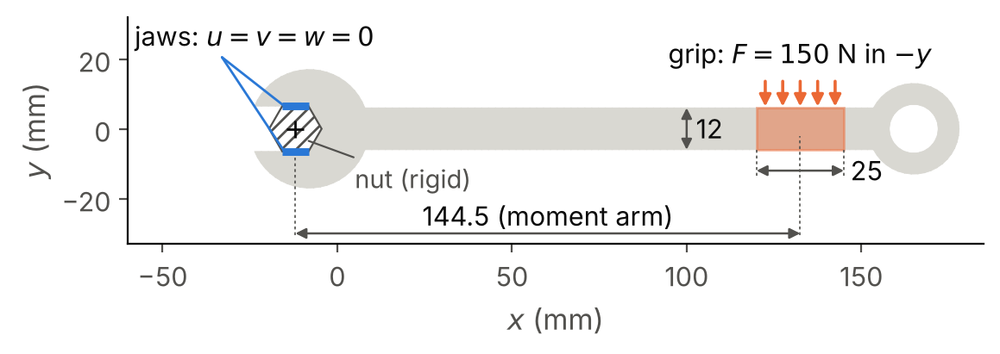
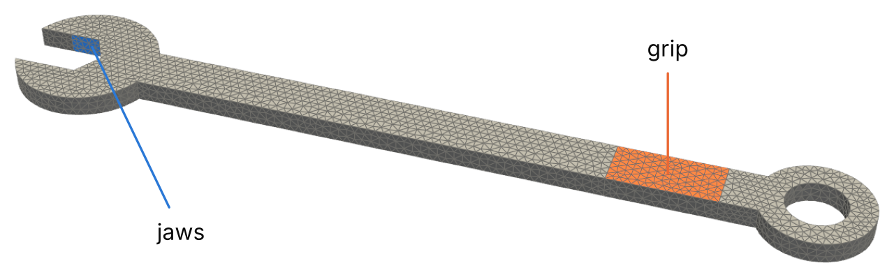
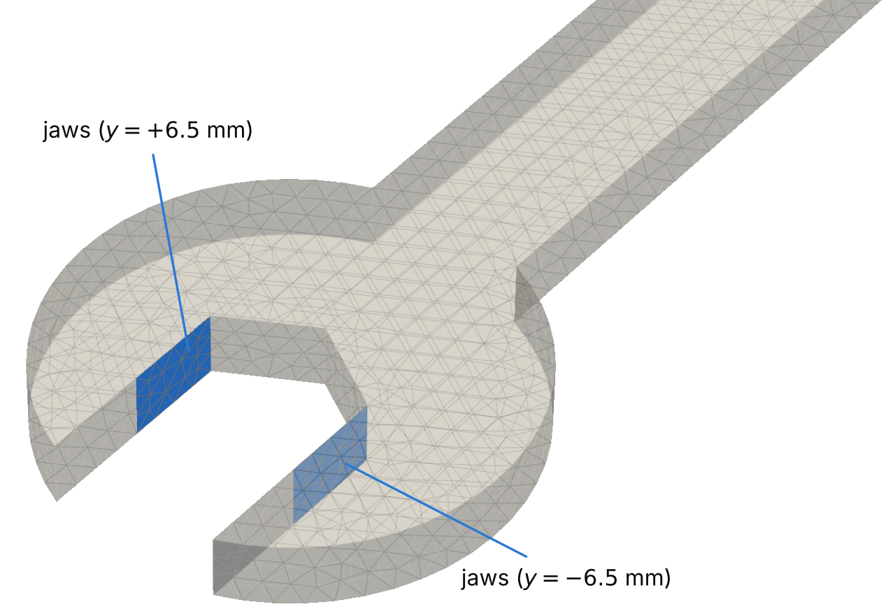
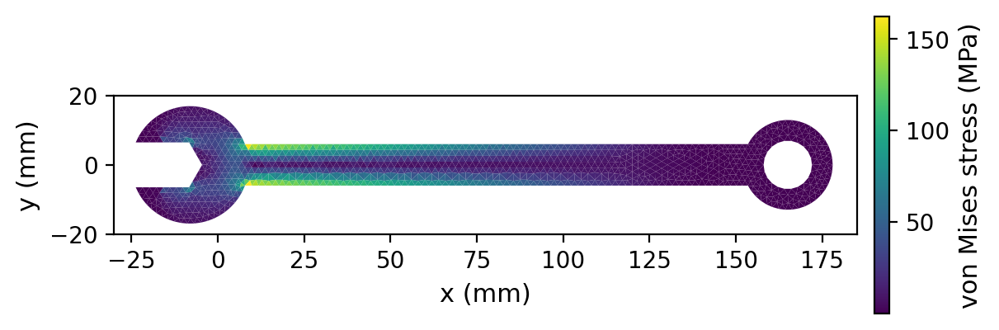

Boundary conditions on an imported mesh: a wrench
=================================================

A generated mesh names its boundaries, for example ``left``, ``right`` and
``top`` for a rectangle.  A mesh imported from a mesh generator or a
computer-aided design (CAD) model has boundaries of any shape, and you name
them before a boundary condition can act on them.  In this tutorial, you
name and check the boundaries of an imported mesh of a steel combination
wrench, define the conditions on them, and solve the three-dimensional
elasticity of the wrench as it tightens a nut.  You check the solution
against the statics of the wrench and beam theory.

The scripts are in ``examples/wrench``.  The mesh functions of
:mod:`dualmesh` name and check the boundaries, and the input of
:class:`dualmesh.problem` solves the wrench.

The problem
-----------

The load case follows the model "Stresses and Strains in a Wrench" of the
COMSOL Application Gallery [COMSOLWrench]_: a structural steel wrench, held
by the nut and loaded by a hand force of :math:`150\ \mathrm{N}`.  The
script ``make_wrench_mesh.py`` builds the wrench of this tutorial with Gmsh
[Gmsh2009]_.  The wrench lies in the :math:`x`-:math:`y` plane and is
:math:`5\ \mathrm{mm}` thick.  The handle has a cross-section of :math:`12
\times 5\ \mathrm{mm^2}` and runs from :math:`x = 0` to :math:`x = 150\
\mathrm{mm}`, where the ring end begins.  The open end at :math:`x < 0` holds
a nut of :math:`13\ \mathrm{mm}` across the flats, whose centre is at
:math:`(-12, 0)\ \mathrm{mm}`.  :numref:`fig-wrench-geometry` shows the
geometry and the boundary conditions.

.. _fig-wrench-geometry:

   The wrench in top view, with dimensions in mm.  The two jaw faces (blue)
   bear on the flats of the rigid nut (hatched), where the displacement
   components :math:`u`, :math:`v` and :math:`w` along :math:`x`,
   :math:`y` and :math:`z` are zero.  The grip (orange) carries a uniform
   traction whose resultant is a force of :math:`150\ \mathrm{N}` along
   :math:`-y`.  The moment arm runs from the centre of the nut to the centroid
   of the grip.

The boundary conditions are:

* The jaws, the two flat faces of the open end that bear on the flats of the
  nut, are fixed.  The nut is rigid, so all three displacement components
  are zero on these faces.
* The grip carries the hand force :math:`F = 150\ \mathrm{N}` along
  :math:`-y`, spread as a uniform shear traction over the upper and lower
  faces of the handle between :math:`x = 120` and :math:`x = 145\
  \mathrm{mm}`.
* All the other faces are free of traction.

The material is steel with Young's modulus :math:`E = 200\ \mathrm{GPa}` and
Poisson's ratio :math:`\nu = 0.3`.  The solid balances its stresses,
:math:`\nabla\cdot\boldsymbol{\sigma} = \mathbf{0}`, where
:math:`\boldsymbol{\sigma}` is the Cauchy stress in :math:`\mathrm{Pa}`, and
the stress follows Hooke's law of the small strain.  The mesh
``wrench.msh`` has 9990 quadratic tetrahedra (``Tet10``) and 18929 nodes,
and the problem is solved with the finite element method (FEM).

Name the boundaries
-------------------

You name the boundaries in one of two ways.

**Physical groups of the mesh file.**  Name the surfaces where you make the
mesh.  ``make_wrench_mesh.py`` splits the faces of the wrench where the
flats of the nut end and where the grip begins and ends, so that the jaws and
the grip are surfaces of their own, and declares them as the physical groups
``jaws`` and ``grip``:

.. literalinclude:: ../../examples/wrench/make_wrench_mesh.py
   :language: python
   :start-at: gmsh.model.addPhysicalGroup(3
   :end-at: "grip")
   :dedent: 4

:func:`~dualmesh.read_mesh` turns every named group of boundary faces into a
side set and a node set of the same name (see :doc:`/user_guide/meshes`).

**Geometric predicates.**  A mesh file without physical groups, such as a
volume mesh made by another tool from a surface mesh, carries no names.
Select the faces by the position of their centroids with
:meth:`~dualmesh.Mesh.add_sideset_by_predicate`.  The jaws are the faces at
:math:`|y| = 6.5\ \mathrm{mm}` between the ends of the flats of the nut, and
the grip is the part of the faces at :math:`|z| = 2.5\ \mathrm{mm}` between
:math:`x = 120` and :math:`x = 145\ \mathrm{mm}`:

.. code-block:: python

   mm = 1.0e-3
   mesh.add_sideset_by_predicate(
       "jaws", lambda x, y, z: abs(abs(y) - 6.5 * mm) < 1e-6 and -15.76 * mm < x < -8.24 * mm
   )
   mesh.add_sideset_by_predicate(
       "grip", lambda x, y, z: abs(abs(z) - 2.5 * mm) < 1e-6 and 120 * mm < x < 145 * mm
   )

A predicate is evaluated on the exterior faces only, so a condition that also
holds inside the body selects no interior face.  The tolerance must exceed
the round-off of the coordinates, and the edges of the selected region must
lie on edges of the mesh, which is why the mesh generator splits the faces at
the ends of the jaws and of the grip.  A predicate given the name of an
existing side set adds its faces to that side set, so name each side set by
one of the two ways only.

Check the boundaries
--------------------

Check the side sets of an imported mesh before you attach a boundary
condition to them.

1. List the side sets.  :func:`~dualmesh.sideset_summary` gives, for every
   side set, the number of faces, the number of nodes, the measure (the area
   in three dimensions) and the range of the coordinates of its nodes:

   .. code-block:: python

      import dualmesh

      mesh = dualmesh.read_mesh("wrench.msh")
      print(dualmesh.sideset_summary(mesh))

   .. code-block:: text

      side set    faces    nodes         area  coordinates of the nodes
      -----------------------------------------------------------------
      grip          392      862       0.0006  x 0.12 to 0.145  y -0.006 to 0.006  z -0.0025 to 0.0025
      jaws           64      158   7.5056e-05  x -0.01575 to -0.008247  y -0.0065 to 0.0065  z -0.0025 to 0.0025

   The command line prints the same table from the mesh file:

   .. code-block:: console

      dualmesh mesh wrench.msh --sidesets wrench_sidesets.vtu

2. Compare the numbers with the drawing.  The grip is two faces of
   :math:`25 \times 12\ \mathrm{mm^2}`, so its area is :math:`6 \times
   10^{-4}\ \mathrm{m^2}`, as in the table.  Each jaw is a flat of the
   hexagon, of length :math:`13 / (2 \cos 30^\circ) = 7.5056\ \mathrm{mm}`,
   through the thickness of :math:`5\ \mathrm{mm}`, so the two jaws have an
   area of :math:`7.5056 \times 10^{-5}\ \mathrm{m^2}`.  A side set with the
   wrong area or the wrong coordinates has selected the wrong faces.

3. Look at them.  :func:`~dualmesh.write_sidesets` writes the exterior
   boundary of the mesh to a file of the Visualization Toolkit (VTK).  Its cell field ``side_set`` holds the
   position of the side set of each face in
   :meth:`~dualmesh.Mesh.sideset_names` plus one, and 0 for a face in no side
   set.  Each side set also has a field of its own name, 1 on its faces and 0
   elsewhere:

   .. code-block:: python

      dualmesh.write_sidesets(mesh, "wrench_sidesets.vtu")

   The option ``--sidesets`` of ``dualmesh mesh`` writes the same file.
   Colour it in ParaView by ``side_set``, or by the field of one side set.
   :numref:`fig-wrench-sidesets` and :numref:`fig-wrench-jaws` show this
   file.

.. _fig-wrench-sidesets:

   The surface mesh of the wrench, with the faces of the side set ``jaws``
   in blue and those of ``grip`` in orange.

.. _fig-wrench-jaws:

   The open end of the wrench, drawn semi-transparent, with the two faces of
   the side set ``jaws``.  Each face spans one flat of the nut through the
   whole thickness of the wrench.

Define the problem
------------------

The function ``wrench`` of ``wrench.py`` builds the input of the problem.

1. Read the mesh file.  A mesh file does not state the unit of its
   coordinates, and ``wrench.msh`` is in m:

   .. literalinclude:: ../../examples/wrench/wrench.py
      :language: python
      :start-at: tool = dualmesh.problem(
      :end-before: tool.physics(
      :dedent: 4

   The input takes the side sets of the file, ``jaws`` and ``grip``, as the
   names of its boundaries.

2. Add the solid and its material.  The mesh is three-dimensional, so the
   solid is too, and ``solid_mechanics`` takes no formulation:

   .. literalinclude:: ../../examples/wrench/wrench.py
      :language: python
      :start-at: tool.physics(
      :end-at: tool.properties(
      :dedent: 4

3. Fix the jaws.  The nut is rigid and bonded to the jaws, so the three
   components of the displacement are zero there.  Load the grip by a
   traction, the force per area:

   .. literalinclude:: ../../examples/wrench/wrench.py
      :language: python
      :start-at: tool.boundary_conditions("jaws"
      :end-at: tool.boundary_conditions("grip"
      :dedent: 4

   All three components on the jaws are needed: with :math:`u` and :math:`v`
   alone the wrench could move freely along :math:`z`, and the stiffness
   matrix would be singular.  The hand force :math:`F = 150\ \mathrm{N}`
   along :math:`-y`, spread uniformly over the area :math:`A` of the grip,
   gives the traction

   .. math::

      t_y = \frac{F_y}{A} = \frac{-150\ \mathrm{N}}{6 \times 10^{-4}\ \mathrm{m^2}}
          = -2.5 \times 10^{5}\ \mathrm{Pa},

   where :math:`F_y` is the component of the force along :math:`y`.  The
   area comes from the table of :func:`~dualmesh.sideset_summary`.  A
   traction that varies over the faces is a formula of :math:`x`, :math:`y`,
   :math:`z` and ``time`` per component.

4. Leave the other faces without a condition.  A face that belongs to no
   condition is free of traction, the natural boundary condition of the
   equilibrium equations.

5. Ask for the quantities to check, and write the displacement:

   .. literalinclude:: ../../examples/wrench/wrench.py
      :language: python
      :start-at: tool.postprocessor("reaction"
      :end-at: tool.output(
      :dedent: 4

   ``boundary_flux: traction_y`` integrates the traction of the solid along
   :math:`y` over the jaws, which is the reaction of the nut.  The line
   ``section`` samples :math:`\sigma_{xx}` across the handle at :math:`x = 60\
   \mathrm{mm}`, and ``edge`` takes the von Mises stress at the edge of that
   section.  ``deflection`` is the smallest displacement along :math:`y`.

Solve the wrench
----------------

Run the script from ``examples/wrench``:

.. code-block:: console

   python wrench.py

It solves the problem with the finite element method (FEM), and it writes the
displacement to ``wrench.vtu``, which ParaView opens, the postprocessors to
``wrench.csv`` and the line to ``wrench_section.csv``, in the working
directory.  The script ``plot_wrench_geometry.py`` draws the figures of the
geometry and of the side sets.

Check the result
----------------

The script compares the solution with two results that do not depend on the
finite element model, and prints each computed value next to its reference:

.. list-table::
   :header-rows: 1
   :widths: 50 50

   * - Quantity
     - Reference
   * - Reaction of the jaws along :math:`y`
     - :math:`F = 150\ \mathrm{N}`, the equilibrium of forces
   * - Bending stress :math:`\sigma_{xx}` at the edge of the handle at
       :math:`x = 60\ \mathrm{mm}`
     - :math:`90.63\ \mathrm{MPa}`, beam theory
   * - Von Mises stress at the same edge
     - :math:`90.63\ \mathrm{MPa}`, beam theory

The reaction is the residual of the equations at the nodes of the jaws, so it
balances the load to the tolerance of the solve.  Beam theory gives the
bending stress at the edge of the handle as

.. math::

   \sigma_{xx} = \frac{M c}{I} = \frac{F (x_g - x)\, (h_s/2)}{b_s h_s^3 / 12},

where :math:`M` is the bending moment at the section :math:`x`, :math:`x_g =
132.5\ \mathrm{mm}` is the centroid of the grip, :math:`h_s = 12\
\mathrm{mm}` is the width of the handle in the plane of bending, :math:`b_s =
5\ \mathrm{mm}` is its thickness, :math:`c = h_s/2` is the distance from the
neutral axis to the edge, and :math:`I` is the second moment of area.  The
function ``bending_stress`` fits a straight line to :math:`\sigma_{xx}`
against :math:`y` along the line ``section`` and multiplies its slope by
:math:`h_s/2`:

.. literalinclude:: ../../examples/wrench/wrench.py
   :language: python
   :pyobject: bending_stress

The shear stress of the bending vanishes at the edge of the handle, so the
stress there is :math:`\sigma_{xx}` alone, and the von Mises stress equals
it.  The test
``test_the_wrench_balances_its_load_and_has_the_bending_stress_of_beam_theory``
in ``tests/python/test_examples.py`` checks the reaction to
:math:`10^{-8}`, the bending stress to :math:`10^{-3}` and the von Mises
stress to :math:`2 \times 10^{-3}` of their references.

   The von Mises stress on the upper face of the wrench, one value per
   element.  Along the handle it grows linearly from the grip towards the
   head, as the bending moment does, and it is highest where the handle
   joins the head.

The largest von Mises stress lies at the
junction of the handle and the head, where the straight edge of the handle
meets the circle of the head at a sharp re-entrant corner.  The stress at a
sharp re-entrant corner of an elastic body is singular, so this value grows
as the mesh is refined.  A real wrench has a fillet there, whose radius sets
the stress concentration.  Every edge where a fixed face meets a free face,
such as the edges of the jaws, is singular as well.
