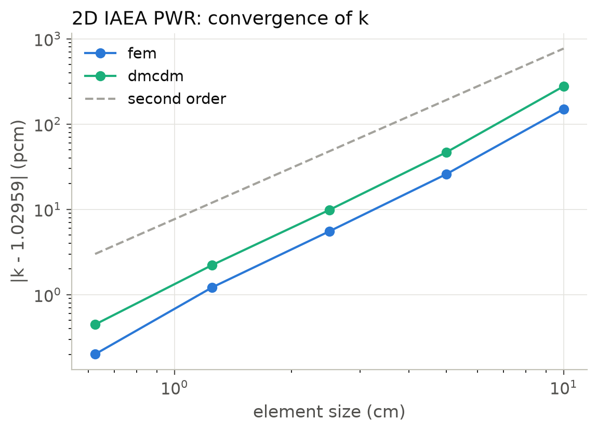
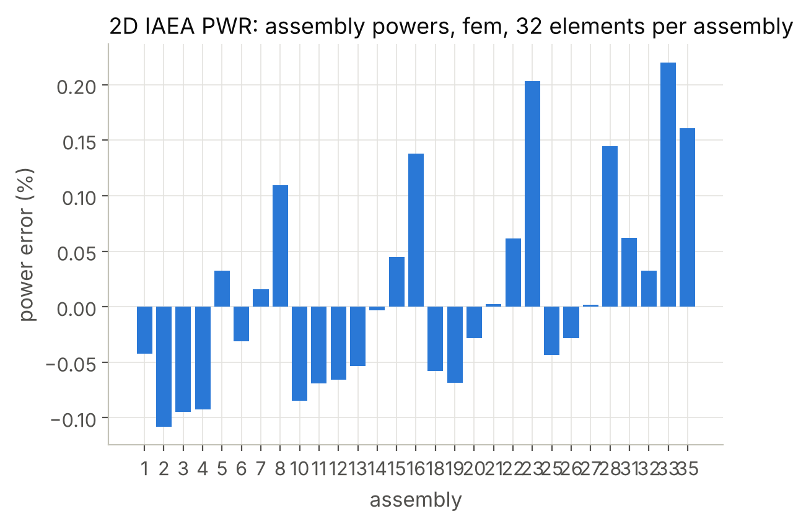

Verification
============

This page gives the evidence that dualmesh computes what it
claims.  Each case compares a computed quantity with a reference: a published
value, an analytical solution, or the result of an independent code.  For each
case you find the problem and its source, the quantity compared, the result,
the method and the mesh, and the test or the script that reproduces it.

The cases use the finite element method (FEM), the dual mesh control domain
method (DMCDM), or both.  The result of a test is the bound that the test
asserts: the test fails when the computed value lies farther from the
reference.  The result of a benchmark script is the computed value and its
error, read from the results file that the script saves beside itself.

Where a problem has no analytical solution, the reference is the DMCDM
solution that [Reddy2024]_ publishes for the same mesh.  Agreement then shows
that the code implements the method as published.

Run the checks
--------------

1. Run the Python tests from the root of the repository:

   .. code-block:: console

      pytest tests/python

2. Run the C++ unit tests of the build in ``build``:

   .. code-block:: console

      ctest --test-dir build --output-on-failure

3. Run the parallel tests on several Message Passing Interface (MPI)
   processes:

   .. code-block:: console

      mpirun -n 4 build/dualmesh_parallel_tests

To run one case, name its test function:

.. code-block:: console

   pytest tests/python/test_heat_transfer.py::test_example_5_4_3_bus_bar -v

The benchmark scripts are in ``verification/benchmarks``.  Each one saves its
results in a cache file beside itself, and ``--plot-only`` redraws the figures
from that cache.

Heat transfer
-------------

In this section :math:`u` is the unknown of a model equation, :math:`T` the
temperature and :math:`k` the thermal conductivity.  The coordinates
:math:`x` and :math:`y` are in the length unit of each source.

Published dual mesh results
~~~~~~~~~~~~~~~~~~~~~~~~~~~

The tests in ``tests/python/test_heat_transfer.py`` solve the heat transfer
examples of [Reddy2024]_ with DMCDM on the published meshes.

.. list-table::
   :header-rows: 1
   :widths: 40 15 30 15

   * - Problem and mesh
     - Source
     - Result
     - Test
   * - :math:`-u'' = 10\cos x` on :math:`(0, 1)`, :math:`u(0) = 0`, and
       :math:`u(1) = 0` or :math:`u'(1) = 0`, four elements, the source
       integrated by the trapezoidal rule
     - Example 3.3.1, Table 3.3.1
     - nodal values within :math:`5 \times 10^{-4}`
     - ``test_example_3_3_1_source_with_trapezoidal_rule``
   * - cooling fin :math:`-u'' + 400u = 0` on :math:`(0, 0.05)`,
       :math:`u(0) = 300`, :math:`u' + 2u = 0` at the tip, 5, 10 and 20
       elements
     - Example 5.3.1, Table 5.3.1
     - nodal values within :math:`6 \times 10^{-3}`, and the heat flow
       :math:`Q(0)` at the base (4817, 4807 and 4804.5) within 0.03 %
     - ``test_example_5_3_1_five_elements``,
       ``test_example_5_3_1_table_5_3_1``
   * - solid cylinder of radius :math:`R_0 = 0.01\ \mathrm{m}`,
       :math:`k = 20\ \mathrm{W/(m\,K)}`, heat generation
       :math:`g_0 = 2 \times 10^8\ \mathrm{W/m^3}`, surface temperature
       :math:`T_s = 100`, axisymmetric, 4 and 8 elements
     - Example 5.3.2, and the analytical
       :math:`T = T_s + g_0 (R_0^2 - r^2) / (4k)` at the radius :math:`r`
     - nodal values to a relative :math:`10^{-10}`, and the heat flow per
       unit length through :math:`r = R_0`,
       :math:`\pi R_0^2 g_0 = 2\pi \times 10^4\ \mathrm{W/m}`, to a relative
       :math:`10^{-10}`
     - ``test_example_5_3_2_cylinder_with_heat_generation``
   * - :math:`-\nabla^2 u = 0` on :math:`(0, 3) \times (0, 2)`, insulated on
       :math:`x = 0` and :math:`y = 0`, :math:`u = 0` on :math:`x = 3`,
       :math:`u = \cos(\pi x / 6)` on :math:`y = 2`, ``Quad4`` meshes of
       :math:`3 \times 2`, :math:`6 \times 4` and :math:`12 \times 8`
     - Example 5.4.1, Table 5.4.1
     - nodal values within :math:`6 \times 10^{-4}`
     - ``test_example_5_4_1_coarse_mesh``, ``test_example_5_4_1_table_5_4_1``
   * - the same problem on :math:`12 \times 8` ``Tri3`` elements, DMCDM and
       FEM
     - Table 5.4.1
     - DMCDM equals FEM to a relative :math:`10^{-11}`, and the published
       values within :math:`6 \times 10^{-4}`
     - ``test_triangles_make_the_dual_mesh_method_equal_the_finite_element_method``
   * - plate of :math:`0.2 \times 0.1\ \mathrm{m}`,
       :math:`k = 0.2\ \mathrm{W/(m\,K)}`, 500 K on the left, 300 K on the
       right, :math:`T = 500 (1 - 10 x^2)` on the top, insulated bottom,
       :math:`8 \times 8` elements
     - Example 5.4.2, Table 5.4.2
     - :math:`T` on :math:`y = 0` and :math:`y = 0.05` within
       :math:`6 \times 10^{-3}\ \mathrm{K}`
     - ``test_example_5_4_2_linear_conduction``
   * - the same plate with :math:`k = 0.2\,(1 + 100\,T)`, by Newton's method
       and by direct iteration
     - Table 6.3.1
     - :math:`T` within :math:`3 \times 10^{-2}\ \mathrm{K}`, the accuracy of
       the relative tolerance :math:`10^{-3}` to which the book iterates
     - ``test_example_6_3_1_temperature_dependent_conductivity``
   * - bus bar of :math:`0.1 \times 0.05\ \mathrm{m}`,
       :math:`k = 20\ \mathrm{W/(m\,K)}`, heat generation
       :math:`10^6\ \mathrm{W/m^3}`, 40 on the left, 10 on the right,
       convection with :math:`75\ \mathrm{W/(m^2\,K)}` to 0 on the top,
       :math:`10 \times 5` elements
     - Example 5.4.3, Table 5.4.3
     - :math:`T` on :math:`y = 0` and :math:`y = 0.05` within
       :math:`5 \times 10^{-3}`
     - ``test_example_5_4_3_bus_bar``
   * - the same bus bar with :math:`k = 20\,(1 + 0.01\,T)`
     - Example 6.3.2
     - linear and nonlinear :math:`T` on :math:`y = 0.05` within
       :math:`5 \times 10^{-3}`
     - ``test_example_6_3_2_nonlinear_bus_bar``
   * - :math:`\partial u / \partial x + \partial u / \partial y =
       Pe^{-1} \nabla^2 u` on the unit square at the Péclet number
       :math:`Pe = 75`, the exact solution on the boundary,
       :math:`50 \times 50` and :math:`100 \times 100` elements
     - Example 5.4.4, and the analytical solution
     - :math:`u` along the diagonal within :math:`2 \times 10^{-5}`
     - ``test_example_5_4_4_advection_diffusion``
   * - :math:`-u'' + 2u^3 = 0` on :math:`(1, 2)`, :math:`u(1) = 1`,
       :math:`u'(2) + u(2)^2 = 0` written as a boundary condition in Python,
       4 and 8 elements
     - Example 6.2.2
     - nodal values within :math:`10^{-3}`
     - ``test_example_6_2_2_cubic_reaction``
   * - bar of length :math:`0.18\ \mathrm{m}` with
       :math:`k = 0.2\,(1 + 0.002\,T)`, 500 K and 300 K at its ends, 4 and 8
       elements
     - Example 6.2.3, Table 6.2.2
     - nodal values within :math:`2 \times 10^{-2}\ \mathrm{K}`
     - ``test_example_6_2_3_temperature_dependent_bar``

Table 5.4.2 prints the last value on :math:`y = 0.05` as 335.34 K.  The test
takes 335.54 K, which fits the rest of the table and the FEM value of 335.49 K
in the book.  Table 5.4.3 is captioned with a :math:`20 \times 10` mesh, and
its values are those of the :math:`10 \times 5` mesh of Fig. 5.4.15(b) and
Example 6.3.2.

Analytical solutions with both methods
~~~~~~~~~~~~~~~~~~~~~~~~~~~~~~~~~~~~~~~

The tests in ``tests/python/test_conduction_methods.py`` solve each problem
with FEM and with DMCDM.

.. list-table::
   :header-rows: 1
   :widths: 40 25 20 15

   * - Problem and mesh
     - Analytical solution
     - Result
     - Test
   * - :math:`-(k(T)\, T')' = 0` with :math:`k = 1 + T/2`,
       :math:`T(0) = 0`, :math:`T(1) = 1`, 40 elements, Newton's method and
       direct iteration
     - :math:`T + T^2/4 = 5x/4` by the Kirchhoff transform
     - nodal values within :math:`10^{-4}`
     - ``test_nonlinear_conduction``
   * - :math:`\partial T / \partial t = \partial^2 T / \partial x^2`,
       :math:`T(x, 0) = \sin \pi x`, 40 elements, Crank-Nicolson with
       :math:`\Delta t = 10^{-3}` to :math:`t = 0.1`
     - :math:`T = e^{-\pi^2 t} \sin \pi x`
     - nodal values within :math:`3 \times 10^{-4}`
     - ``test_transient_slab``
   * - fin :math:`-u'' + 4u = 0` on :math:`(0, 1)`, :math:`u(0) = 100`, a
       convective tip with the coefficient 2, 8, 16 and 32 elements
     - hyperbolic functions of :math:`x`
     - largest nodal error falls at an order above 1.8
     - ``test_convective_boundary_condition``
   * - :math:`-(k u')' = 1` with :math:`k = 1` for :math:`x < 0.6` and
       :math:`k = 3` beyond, :math:`u = 0` at both ends, 10, 20 and 40
       elements
     - piecewise quadratic with a continuous flux
     - nodal values to :math:`10^{-12}`
     - ``test_a_jump_of_the_conductivity_between_blocks_is_exact_at_the_nodes``

Fluids
------

In this section :math:`\mathbf{v} = (v_x, v_y)` is the velocity, :math:`p` the
pressure, :math:`\rho` the density and :math:`\mu` the dynamic viscosity.  The
Reynolds number is :math:`Re = \rho U L / \mu`, with :math:`U` a reference
speed and :math:`L` a reference length of the problem.

Benchmarks
~~~~~~~~~~

Four benchmarks have a page each in :doc:`benchmarks/index`.  The table gives
the result on the finest mesh of each.

.. list-table::
   :header-rows: 1
   :widths: 34 30 18 18

   * - Benchmark
     - Quantity
     - DMCDM
     - FEM
   * - :doc:`benchmarks/dfg_steady`, :math:`Re = 20` [SchaeferTurek1996]_
     - relative error of the drag coefficient
     - :math:`+0.0008\ \%`
     - :math:`+0.0008\ \%`
   * - :doc:`benchmarks/dfg_unsteady`, :math:`Re = 100` [SchaeferTurek1996]_
     - relative error of the Strouhal number
     - :math:`-0.10\ \%`
     - :math:`-0.06\ \%`
   * - :doc:`benchmarks/kovasznay`, :math:`Re = 40` [Kovasznay1948]_
     - :math:`L^2` error of :math:`v_x`, and its order
     - :math:`9.48 \times 10^{-4}` (1.98)
     - :math:`1.02 \times 10^{-3}` (1.98)
   * - :doc:`benchmarks/cavity`, :math:`Re = 1000` [Erturk2005]_
     - largest difference of :math:`v_x` on the vertical centerline
     - 0.0020
     - 0.0015

Analytical and manufactured solutions
~~~~~~~~~~~~~~~~~~~~~~~~~~~~~~~~~~~~~

A manufactured solution is a smooth field chosen in advance, whose forcing the
code derives (see :ref:`verification-mms`).  The equal-order elements carry
pressure stabilization, and the Taylor-Hood element has a quadratic velocity
and a linear pressure.

.. list-table::
   :header-rows: 1
   :widths: 40 30 30

   * - Problem and mesh
     - Result
     - Test
   * - Poiseuille flow in a :math:`4 \times 1` channel, :math:`\mu = 1`,
       inflow :math:`v_x = 4y(1 - y)`, do-nothing outlet, exact pressure
       :math:`p = 8(4 - x)`, ``Quad9`` and ``Tri6``, both methods,
       :math:`\rho = 0` and 10
     - nodal velocity to :math:`10^{-11}` and pressure to :math:`10^{-9}`
     - ``test_poiseuille.py::test_quadratic_elements_are_exact``
   * - the same flow on ``Quad4`` and ``Tri3``, 8, 16 and 32 cells across
     - velocity at an order above 1.9, pressure above 1.0, largest velocity
       error below :math:`2 \times 10^{-3}`
     - ``test_poiseuille.py::test_linear_elements_converge_at_second_order``
   * - manufactured flow, equal-order elements, distorted ``Quad4``,
       ``Tri3``, and axisymmetric ``Quad4`` with the axis, both methods
     - orders on the two finest meshes above 1.8 for :math:`\mathbf{v}` in
       :math:`L^2`, 0.9 for :math:`\mathbf{v}` in :math:`H^1` and 1.2 for
       :math:`p` in :math:`L^2`
     - ``test_pressure_velocity.py``
   * - manufactured flow, Taylor-Hood element on distorted ``Quad9``,
       ``Tri6`` and ``Quad8``, axisymmetric with the axis, and enclosed with a
       pinned pressure
     - orders above 2.8, 1.8 and 1.8 in the same norms, whose theoretical
       values are 3, 2 and 2
     - ``test_Taylor_Hood.py``
   * - the same on ``Tet10`` and ``Hex27``, 2 and 4 elements per side
     - orders above 2.7, 1.8 and 1.8
     - ``test_Taylor_Hood.py::test_three_dimensional_flow``
   * - inf-sup constant of the Taylor-Hood element under refinement
     - above 0.3 on every mesh, and on the finest above 95 % of its value on
       the coarsest, while the equal-order pairs give a constant below
       :math:`10^{-6}`
     - ``test_Taylor_Hood.py``
   * - decaying Taylor-Green vortex with walls, :math:`\mu / \rho = 0.1`,
       projection time integration, :math:`8^2`, :math:`16^2` and
       :math:`32^2` ``Quad4`` and ``Tri3`` elements, both methods
     - velocity at an order above 1.85 over the two refinements, pressure
       error divided by more than 7
     - ``test_projection.py``
   * - the same vortex in a periodic box, :math:`8^2` to :math:`64^2`
       elements
     - velocity at an order above 1.9 on every refinement, pressure above 1.9
       from :math:`16^2` on
     - ``test_projection.py``
   * - stagnation flow :math:`\mathbf{v} = g(t)\,(x, -y)`, which ``Quad9``
       elements hold exactly, :math:`\Delta t = 0.05`, 0.025 and 0.0125
     - orders of the pressure in time above 0.9, 1.95 and 2.6 with BDF1, BDF2
       and BDF3, the backward difference formulas of order 1, 2 and 3
     - ``test_projection.py::test_the_time_integration_has_its_order``
   * - a uniform body force on a fluid at rest in a periodic box
     - :math:`v_x = f t / \rho` to a relative :math:`10^{-9}`
     - ``test_projection.py::test_the_body_force_of_the_flow_is_applied``
   * - the accelerating shear flow :math:`\mathbf{v} = (g(t) + y, 0)`,
       :math:`p = -\rho g'(t) x` with :math:`g(t) = 1 + t / 2`, on
       ``Quad4`` and ``Hex8`` meshes with hanging nodes, both methods
     - velocity and pressure exact to :math:`10^{-7}`
     - ``test_projection.py::test_a_linear_flow_stays_exact_across_hanging_nodes``
   * - the uniform body force on ``Quad4`` meshes with hanging nodes, and the
       channel driven by a body force, whose second row is split (FEM)
     - :math:`v_x = f t / \rho` to a relative :math:`10^{-9}`, and the force
       on the walls equal to the body force to a relative :math:`10^{-6}`
     - ``test_projection.py``

Lid-driven cavity at Re = 100
~~~~~~~~~~~~~~~~~~~~~~~~~~~~~

The unit square has a lid that slides at :math:`U = 1`.  The tests compare the
velocities on the two centerlines with the tables of [Ghia1982]_.

.. list-table::
   :header-rows: 1
   :widths: 50 25 25

   * - Formulation and mesh
     - Largest difference
     - Test
   * - equal-order, :math:`32 \times 32` ``Quad4``, both methods
     - below 0.015
     - ``test_pressure_velocity.py::test_cavity_matches_ghia``
   * - Taylor-Hood, :math:`16 \times 16` ``Quad9``
     - below 0.01
     - ``test_Taylor_Hood.py::test_cavity_matches_ghia``

Published penalty results
~~~~~~~~~~~~~~~~~~~~~~~~~

The tests in ``tests/python/test_fluids.py`` solve the penalty flow examples of
[Reddy2024]_ with DMCDM.  The penalty formulation replaces the pressure by
:math:`p = -\gamma \nabla \cdot \mathbf{v}`, with the penalty parameter
:math:`\gamma = 10^8`.

.. list-table::
   :header-rows: 1
   :widths: 40 15 30 15

   * - Problem and mesh
     - Source
     - Result
     - Test
   * - creeping flow squeezed between plates of half length :math:`a = 6`
       and half gap :math:`b = 2`, the top plate moving down at
       :math:`V_0 = 1`, graded :math:`20 \times 16` mesh
     - Example 9.8.3, Table 9.8.2
     - :math:`v_x` profiles at two stations within :math:`2 \times 10^{-3}`
     - ``test_example_9_8_3_squeezed_flow``
   * - the pressure of the same flow in the interior
     - the approximate solution
       :math:`p = 3 \mu V_0 (a^2 + y^2 - x^2) / (2 b^3)`
     - correlation above 0.999, slope within 5 % of 1
     - ``test_example_9_8_3_squeezed_flow``
   * - lid-driven cavity at :math:`Re = 0` and :math:`Re = 1000`, a
       :math:`16 \times 20` mesh graded towards the lid
     - Example 9.8.4, Table 9.8.3
     - :math:`v_x` on the vertical centerline within
       :math:`2 \times 10^{-3}`, at :math:`Re = 1000` by Newton's method and
       by direct iteration with the relaxation 0.5
     - ``test_example_9_8_4_cavity_Stokes``,
       ``test_example_9_8_4_cavity_Reynolds_1000``,
       ``test_example_9_8_4_cavity_Reynolds_1000_by_direct_iteration``
   * - the divergence of the Stokes cavity flow
     - :math:`\nabla \cdot \mathbf{v} = 0`
     - largest value below :math:`10^{-5}`
     - ``test_penalty_flow_is_almost_divergence_free``

Solid mechanics and structures
------------------------------

In this section :math:`\mathbf{u} = (u_x, u_y)` is the displacement,
:math:`E` Young's modulus, :math:`\nu` Poisson's ratio and
:math:`\boldsymbol{\sigma}` the Cauchy stress.

Plane and axisymmetric elasticity
~~~~~~~~~~~~~~~~~~~~~~~~~~~~~~~~~

The tests are in ``tests/python/test_solid_mechanics.py`` and use DMCDM.

.. list-table::
   :header-rows: 1
   :widths: 40 22 23 15

   * - Problem and mesh
     - Reference
     - Result
     - Test
   * - quadrant of a plate under the uniform edge stress :math:`t_0`
     - Example 9.8.1 of [Reddy2024]_, :math:`u_x(a) = t_0 a / E` at the
       edge :math:`x = a`
     - edge displacement to a relative :math:`10^{-12}`, stress uniform to a
       relative :math:`10^{-9}`
     - ``test_example_9_8_1_uniform_edge_stress``
   * - cantilevered plate of :math:`120 \times 160\ \mathrm{in}`, thickness
       :math:`0.036\ \mathrm{in}`, :math:`E = 30 \times 10^6\ \mathrm{psi}`,
       :math:`\nu = 0.25`, edge load :math:`10\ \mathrm{lb/in}`, 1, 2, 4 and
       8 elements per side
     - Example 9.8.2, Table 9.8.1 of [Reddy2024]_
     - corner displacements within :math:`5 \times 10^{-7}\ \mathrm{in}`,
       and :math:`\sigma_{xx}` at the centre of the element next to the
       support within 0.02 %
     - ``test_example_9_8_2_plate_with_edge_load``
   * - thick cylinder of radii :math:`0.05` and :math:`0.1\ \mathrm{m}`
       under the internal pressure :math:`120\ \mathrm{MPa}`,
       :math:`E = 200\ \mathrm{GPa}`, :math:`\nu = 0.3`, a plane-strain
       quadrant, ``Quad4`` meshes of :math:`4 \times 10`, :math:`8 \times 19`
       and :math:`12 \times 29`
     - Section 9.9.4.1, Table 9.9.1 of [Reddy2024]_
     - radial displacements within :math:`5 \times 10^{-4}\ \mathrm{mm}`,
       the accuracy that the book's description of its mesh allows, which
       gives the subdivisions across the wall and the element count only
     - ``test_example_9_9_4_1_pressurized_cylinder_quadrilaterals``
   * - the same cylinder on ``Quad4`` and ``Tri3`` meshes up to
       :math:`16 \times 38`
     - the Lamé solution [TimoshenkoGoodier1970]_
     - the error at the bore falls on every refinement, and is below 1 % on
       the finest mesh of each element type
     - ``test_pressurized_cylinder_converges_to_the_analytical_solution``
   * - the same cylinder as an axisymmetric problem, 40 elements across the
       wall
     - the Lamé solution
     - radial displacement at nine radii within 0.2 %
     - ``test_axisymmetric_pressurized_cylinder_matches_plane_strain``
   * - plate with a hole of radius 1 in an annulus of radius 20 under remote
       uniaxial tension :math:`\sigma`, :math:`30 \times 30` graded elements
     - the hoop stress :math:`3\sigma` at the hole of an infinite plate
       [TimoshenkoGoodier1970]_
     - within 5 %
     - ``test_plate_with_a_circular_hole_stress_concentration``

Beams
~~~~~

The tests in ``tests/python/test_beams.py`` solve the beam examples of Chapter
7 of [Reddy2024]_ with DMCDM.  The beam has the length
:math:`L = 100\ \mathrm{in}`, a :math:`1 \times 1\ \mathrm{in}` section, the
moduli :math:`30 \times 10^6\ \mathrm{psi}` on top and
:math:`3 \times 10^6\ \mathrm{psi}` at the bottom, :math:`\nu = 0.3` and the
uniform load :math:`q_0 = 0.5\ \mathrm{lb/in}`.  The models are the
Euler-Bernoulli mixed model, the Timoshenko displacement model and the
Timoshenko mixed model, on half of the beam.  The book prints four digits, and
the tests accept :math:`1.1 \times 10^{-4}` in the printed quantity.

.. list-table::
   :header-rows: 1
   :widths: 45 20 35

   * - Problem and mesh
     - Source
     - Test
   * - centre deflection of the pinned homogeneous beam, 4 to 32 elements
     - Table 7.5.1
     - ``test_table_7_5_1_pinned_homogeneous_beam``
   * - centre moment of the mixed models equal to :math:`q_0 L^2 / 8` to a
       relative :math:`10^{-10}`, 4 to 32 elements
     - Table 7.5.2
     - ``test_table_7_5_2_bending_moment_is_exact``
   * - normalized centre deflection of functionally graded pinned beams,
       seven power-law indices, 16 elements
     - Table 7.5.3
     - ``test_table_7_5_3_functionally_graded_pinned_beam``
   * - normalized centre deflection of clamped beams, 4 to 64 elements
     - Table 7.5.4
     - ``test_table_7_5_4_clamped_homogeneous_beam``
   * - von Kármán bending of the pinned beam, six loads, 16 elements, by
       Newton's method
     - Table 7.6.1
     - ``test_table_7_6_1_nonlinear_pinned_beam``
   * - the same at :math:`q_0 = 10\ \mathrm{lb/in}` by direct iteration with
       the acceleration parameter 0.35
     - Table 7.6.1
     - ``test_nonlinear_beam_direct_iteration_with_acceleration``

With the shear term integrated by the full rule, the displacement model locks,
and its deflection falls below a fifth of the deflection with reduced
integration (``test_reduced_integration_removes_shear_locking``).

Plates
~~~~~~

The tests in ``tests/python/test_plates.py`` solve the plate examples of
Chapters 8 and 10 of [Reddy2024]_ with DMCDM.  The circular plates have the
radius :math:`10\ \mathrm{in}`, the thickness :math:`0.1\ \mathrm{in}` and the
uniform load :math:`q_0 = 0.5`.  The rectangular plates have the side
:math:`1\ \mathrm{in}` and the thickness :math:`0.01\ \mathrm{in}`, modelled on
one quarter.

.. list-table::
   :header-rows: 1
   :widths: 45 20 35

   * - Problem, mesh and result
     - Source
     - Test
   * - centre deflection of the hinged homogeneous circular plate, first-order
       shear deformation model, 2 to 32 elements, within
       :math:`1.1 \times 10^{-4}`, and the analytical value 0.1159
     - Table 8.6.1
     - ``test_table_8_6_1_hinged_homogeneous_circular_plate``
   * - centre deflection of clamped functionally graded circular plates, ten
       power-law indices, 32 elements, within :math:`1.1 \times 10^{-4}` of
       the table and 0.5 % of Eq. (8.6.6b)
     - Table 8.6.2
     - ``test_table_8_6_2_clamped_functionally_graded_circular_plate``
   * - the mixed classical plate model on the same plates, 2 to 64 elements
       and eleven power-law indices, within :math:`1.1 \times 10^{-4}`
     - Tables 8.6.1 and 8.6.2
     - ``test_table_8_6_1_mixed_classical_plate``,
       ``test_table_8_6_2_mixed_classical_plate``
   * - bending moment of the mixed classical model, hinged and clamped,
       within 5 % of :math:`q_0 a^2 / 16` away from the centre, with
       :math:`a` the radius
     - Eqs. (8.6.4d) and (8.6.6d)
     - ``test_mixed_classical_plate_bending_moment``
   * - normalized centre deflection of clamped functionally graded square
       plates, six power-law indices, :math:`2 \times 2` to
       :math:`16 \times 16` elements, within :math:`2.1 \times 10^{-5}`
     - Table 10.5.1
     - ``test_table_10_5_1_clamped_functionally_graded_plate``

A nonlinear bar
~~~~~~~~~~~~~~~

A bar with the axial stiffness :math:`EA (1 + 1.5u' + 0.5u'^2)`, written as a
kernel in Python, carries three end loads on 8 elements.  Its tip
displacements agree with Example 6.2.4 of [Reddy2024]_ within
:math:`10^{-3}` (``test_heat_transfer.py::test_example_6_2_4_large_deformation_bar``).

Coupled problems
----------------

Natural convection in a square cavity
~~~~~~~~~~~~~~~~~~~~~~~~~~~~~~~~~~~~~

The benchmark of de Vahl Davis [DeVahlDavis1983]_ couples the flow and the
heat in both directions.  The left wall of the square cavity is hot, the right
wall cold, the top and bottom are adiabatic, and the fluid is air at the
Prandtl number :math:`Pr = 0.71`.  The Rayleigh number :math:`Ra` measures the
buoyancy against the diffusion of momentum and heat.  The average Nusselt
number :math:`Nu` is the heat flow through the hot wall, and :math:`u_m` and
:math:`v_m` are the largest :math:`v_x` on the vertical centerline and the
largest :math:`v_y` on the horizontal centerline, in units of
:math:`\kappa / L`, with :math:`\kappa` the thermal diffusivity and :math:`L`
the side.  The example ``examples/natural_convection`` solves a cavity of air
of side :math:`100\ \mathrm{mm}` in SI units, with the default equal-order
formulation of the flow, on a mesh of :math:`80 \times 80` cells whose lines
cluster at the walls with a cosine spacing.

.. list-table:: Reference values of [DeVahlDavis1983]_
   :header-rows: 1

   * - :math:`Ra`
     - :math:`Nu`
     - :math:`u_m`
     - :math:`v_m`
   * - :math:`10^3`
     - 1.118
     - 3.649
     - 3.697
   * - :math:`10^4`
     - 2.243
     - 16.178
     - 19.617
   * - :math:`10^5`
     - 4.519
     - 34.73
     - 68.59

The test ``test_natural_convection_has_the_Nusselt_numbers_of_de_Vahl_Davis``
in ``tests/python/test_examples.py`` checks the example, with both methods,
at every :math:`Ra` of the table: :math:`Nu` within 0.5 % and :math:`u_m` and
:math:`v_m` within 2 %, with the largest differences 0.18 % and 0.19 % at
:math:`Ra = 10^5`.

The tests in ``tests/python/test_multiphysics.py`` solve the dimensionless
Boussinesq equations of :doc:`theory/fluids` with the penalty formulation on a
:math:`32 \times 32` mesh of the same spacing, and check, with both methods:

* at every :math:`Ra` of the table, :math:`Nu` within 0.5 % and :math:`u_m`
  and :math:`v_m` within 2 %, with the default advection scheme of the heat
  (``test_natural_convection_matches_de_vahl_davis``),
* at :math:`Ra = 10^5` with ``advection_scheme="central"``, :math:`Nu` within
  0.2 % and :math:`u_m` and :math:`v_m` within 1 %
  (``test_natural_convection_without_streamline_stabilisation_of_the_heat``),
* the heat entering at the hot wall leaves at the cold wall to a relative
  :math:`10^{-9}`, and Newton's method takes at most 8 iterations per decade
  of :math:`Ra`,
* the quadratic convergence of Newton's method on a :math:`16 \times 16` mesh
  at :math:`Ra = 10^4`, where each relative step :math:`s_{k+1}` stays below
  :math:`10\, s_k^2` (``test_the_coupling_is_exact_in_newtons_method``).

Thermal stress
~~~~~~~~~~~~~~

A unit square of steel, :math:`E = 200\ \mathrm{GPa}`, :math:`\nu = 0.3`, the
linear expansion coefficient :math:`\alpha = 1.2 \times 10^{-5}\ \mathrm{1/K}`,
is heated uniformly by :math:`\Delta T = 100\ \mathrm{K}`.  The tests in
``tests/python/test_solid_mechanics.py`` compare the stress and the strain
with the analytical values to a relative :math:`10^{-9}` or better:

* fully restrained in plane strain, every normal stress is
  :math:`-E \alpha \Delta T / (1 - 2\nu)`, with both methods,
* fully restrained in plane stress, the in-plane normal stresses are
  :math:`-E \alpha \Delta T / (1 - \nu)`, with both methods,
* free in plane strain, the out-of-plane stress is :math:`-E \alpha \Delta T`
  and the in-plane strain :math:`(1 + \nu) \alpha \Delta T`,
* the same restrained body in three dimensions gives the plane-strain stress.

Eigenvalue problems and reactor criticality
-------------------------------------------

Eigenvalues of model operators
~~~~~~~~~~~~~~~~~~~~~~~~~~~~~~

The tests in ``tests/python/test_eigenvalue_study.py`` compare the eigenvalue
study with exact eigenvalues, with both methods:

* The Laplacian on the unit square with zero boundary values has the
  eigenvalues :math:`\pi^2 (m^2 + n^2)` for the integers :math:`m` and
  :math:`n`.  The first four converge at an order above 1.9 on
  :math:`8^2`, :math:`16^2` and :math:`32^2` elements, and the double
  eigenvalue :math:`5\pi^2` is found twice to a relative :math:`10^{-8}`.
* The operator :math:`-u'' + 4u'` on :math:`(0, 1)` is not symmetric.  Its
  eigenvalues :math:`(n\pi)^2 + 4` are reached within 0.2 % on 128 elements,
  at an order above 1.8.
* Two diffusion equations coupled by a rotation of rate :math:`\omega = 30`
  have the complex eigenvalues :math:`\lambda_L \pm i\omega`, with
  :math:`\lambda_L` an eigenvalue of the Laplacian, found to a relative
  :math:`10^{-8}`.

Criticality in diffusion theory
~~~~~~~~~~~~~~~~~~~~~~~~~~~~~~~

The effective multiplication factor :math:`k_\mathrm{eff}` of a reactor is
the inverse of the smallest eigenvalue of its neutron diffusion equations.  Its
error is given in pcm, units of :math:`10^{-5}`.  The tests in
``tests/python/test_criticality.py`` write the diffusion equations with
``general_form_PDE`` (see :ref:`tutorial-criticality`) and compare
:math:`k_\mathrm{eff}` with the analytical values of [Lee2025]_:

* a bare slab converges at an order above 1.9, to within
  :math:`2 \times 10^{-5}`, with both methods,
* a bare infinite cylinder and a bare sphere within a relative
  :math:`2 \times 10^{-5}`, and a bare finite cylinder within
  :math:`3 \times 10^{-5}`,
* a slab with the vacuum condition :math:`-D\, \partial \phi / \partial n =
  \phi / r`, for :math:`r = 2` and :math:`r = 2.1312`, within a relative
  :math:`10^{-6}`, with :math:`D` the diffusion coefficient and :math:`\phi`
  the neutron flux,
* a two-group infinite medium gives :math:`k_\infty = 1.125` to a relative
  :math:`10^{-12}`, and a two-group bare core with a transverse buckling
  agrees within a relative :math:`10^{-4}`.

The 2D IAEA PWR benchmark
~~~~~~~~~~~~~~~~~~~~~~~~~

The two-dimensional benchmark of the International Atomic Energy Agency
(IAEA) is a quarter of the core of a pressurized water reactor (PWR)
([ANL7416]_, problem 11-A2).  The core has 177 fuel assemblies of
:math:`20\ \mathrm{cm}`, two fuel compositions and nine fully rodded
assemblies, and a water reflector of :math:`20\ \mathrm{cm}` surrounds it.  The
model is two-group diffusion theory with the axial buckling
:math:`0.8 \times 10^{-4}\ \mathrm{cm^{-2}}` in every region and group.  The
outer boundary has no incoming current, which the benchmark states as
:math:`\partial \phi_g / \partial n = -0.4692\, \phi_g / D_g` for the flux
:math:`\phi_g` and the diffusion coefficient :math:`D_g` of group :math:`g`.
The script ``verification/benchmarks/neutronics/run_iaea_2d_pwr.py`` writes
this condition as ``"-diffusion_1*dphi1/dn = phi1/2.1312"`` and its thermal
counterpart.  The reference is the extrapolated finite-difference solution of
problem 11-A2-1: :math:`k_\mathrm{eff} = 1.02959` (Table 1) and the zone
average thermal fluxes (Table 3).  The assembly powers follow from these fluxes
and are normalized to a core average of one.

Each assembly has :math:`m \times m` square elements.  :numref:`iaea-2d-results`
gives the results that the script writes to
``verification/benchmarks/neutronics/iaea_2d_pwr_results.csv``.

.. _iaea-2d-results:

.. table:: The 2D IAEA PWR benchmark: error of :math:`k_\mathrm{eff}` (pcm)
   and largest error of the assembly powers (%) for :math:`m \times m`
   elements per assembly.

   ======  ===============  ===============
   m       ``FEM``          ``DMCDM``
   ======  ===============  ===============
   2       150.2 / 32.74    277.3 / 50.39
   4       25.9 / 8.38      46.8 / 12.39
   8       5.5 / 2.18       9.9 / 3.21
   16      1.2 / 0.61       2.2 / 0.87
   32      0.2 / 0.22       0.4 / 0.29
   ======  ===============  ===============

Both methods converge to the reference at second order in the element size.
At :math:`m = 32` their error of :math:`k_\mathrm{eff}` is below 0.5 pcm, and
their largest error of the assembly powers is below 0.3 %.  The test
``test_criticality.py::test_the_iaea_pwr_benchmark`` runs FEM with
:math:`m = 4` and 8, and asserts an error below 6 pcm at :math:`m = 8` and an
order above 1.8.

   Error of :math:`k_\mathrm{eff}` against the element size, with both
   methods and a line of second order.

   Error of the power of each assembly, FEM with 32 elements per assembly.

To reproduce the table and write the figures to the docs, run:

.. code-block:: console

   python verification/benchmarks/neutronics/run_iaea_2d_pwr.py docs/_static/figures/neutronics

Adaptivity
----------

The L-shaped domain
~~~~~~~~~~~~~~~~~~~

The domain is the square :math:`(-1, 1)^2` without the quadrant
:math:`x > 0`, :math:`y < 0`.  Laplace's equation has the solution
:math:`u = r^{2/3} \sin(2\theta / 3)` in the polar coordinates :math:`r` and
:math:`\theta` centred on the re-entrant corner, which gives the boundary
values.  Its gradient is unbounded at the corner, so uniform refinement
converges slowly.  For a smooth solution, linear elements give a nodal error
that falls like :math:`N^{-1}` with the number of nodes :math:`N`.

The test ``test_adaptivity.py::test_adaptive_refinement_beats_uniform_refinement_at_a_re_entrant_corner``
starts from 24 ``Tri3`` elements and 21 nodes.  It runs five uniform cycles,
and twelve adaptive cycles that refine the elements holding 40 % of the
estimated error.  It fits the slope of the logarithm of the largest nodal error
against :math:`\log N` and asserts that:

1. the uniform slope lies between :math:`-0.45` and :math:`-0.2`, near the
   :math:`-1/3` of this corner,
2. the adaptive slope over the last seven cycles is below :math:`-0.8`, near
   the :math:`-1` of a smooth solution,
3. the last adaptive mesh has fewer nodes and a smaller error than the last
   uniform mesh.

Exact solutions on adapted meshes
~~~~~~~~~~~~~~~~~~~~~~~~~~~~~~~~~

The tests in ``tests/python/test_adaptivity.py`` check, with both methods
where the test names them:

* A mesh refined four times in one corner reproduces a linear field to
  :math:`10^{-11}`, so the refinement leaves no hanging node
  (``test_refinement_leaves_no_hanging_node``).
* Quadrilateral and hexahedral meshes with hanging nodes reproduce a linear
  field to :math:`10^{-11}` (``test_hanging_nodes_pass_the_patch_test``), and
  the heat of a unit source leaves through the boundary to a relative
  :math:`10^{-10}` (``test_the_source_leaves_through_the_boundary_with_hanging_nodes``).
* A steel plate pulled by the traction :math:`\sigma = 1\ \mathrm{MPa}` on a
  mesh that adapts every two steps keeps the mean displacement
  :math:`\sigma t^2 / (2 \rho L)` of its momentum balance to a relative
  :math:`10^{-6}`, on triangles and quadrilaterals
  (``test_a_plate_pulled_by_a_traction_keeps_its_momentum_through_the_adapted_meshes``).
* A body falling under its weight keeps the velocity :math:`-g t` and the
  displacement :math:`-g t^2 / 2` to a relative :math:`10^{-6}` across a
  change of mesh, with :math:`g` the gravitational acceleration
  (``test_a_body_falling_under_its_weight_keeps_its_velocity_across_a_change_of_mesh``).

Parallel runs
-------------

A distributed solve must give the serial answer.  The tests in
``tests/python/test_parallel.py`` run the distributed code path in one process
and compare it with the serial solve:

* steady conduction with both methods, four linear solvers and both
  gather-scatter libraries, PETSc and gslib [gslib]_, and a transient
  conduction, to :math:`10^{-8}`,
* the equal-order flow, the Taylor-Hood flow, periodic boundaries and the
  split preconditioners of a flow to :math:`10^{-8}`,
* the post-processors, error norms and gap conditions to a relative
  :math:`10^{-9}` or better,
* one and four threads of the assembly to :math:`10^{-12}`.

The program ``dualmesh_parallel_tests``, launched with ``mpirun``, checks the
same on several processes (``tests/cpp/parallel_tests.cpp``):

* steady conduction on a :math:`12 \times 12` mesh with both methods, for every
  partitioner of the build, both gather-scatter libraries and five linear
  solvers (the automatic choice, additive Schwarz with incomplete and with
  exact subdomain solves, smoothed aggregation multigrid and the direct solver
  MUMPS), to :math:`10^{-8}`,
* a concentrated load, which only its owning process applies, to
  :math:`10^{-8}`,
* plane elasticity and a gap between bodies on different processes, to a
  relative :math:`10^{-8}` and :math:`10^{-9}`,
* a transient run restarted from its checkpoint on another partition, to
  :math:`10^{-12}` after ten steps,
* the projection time integration of the Taylor-Green vortex, to
  :math:`10^{-7}` in the velocity and the pressure.

.. _verification-openfoam:

Comparison with OpenFOAM
------------------------

The scripts in ``verification/openfoam`` run OpenFOAM [OpenFOAM1998]_ and
dualmesh on the same problem and print both results.  They need
an OpenFOAM installation.

1. Load the OpenFOAM environment, for example:

   .. code-block:: console

      . /usr/lib/openfoam/openfoam2406/etc/bashrc

2. Run each case and its comparison from ``verification/openfoam``:

   .. code-block:: console

      ./cavity_openfoam.sh 64        && python compare_cavity.py --resolution 64
      ./conduction_openfoam.sh 40 20 && python compare_conduction.py --nx 40 --ny 20
      ./plate_hole_openfoam.sh       && python compare_plate_hole.py

Lid-driven cavity at Re = 100
~~~~~~~~~~~~~~~~~~~~~~~~~~~~~

``icoFoam``, the transient incompressible solver of OpenFOAM, marches the
cavity to its steady state on a uniform :math:`64 \times 64` mesh.
``compare_cavity.py`` solves the same cavity with the penalty formulation and
DMCDM, and prints both centerline profiles beside the tables of [Ghia1982]_,
with their largest differences.

Steady conduction in a plate
~~~~~~~~~~~~~~~~~~~~~~~~~~~~

The plate of :math:`0.2 \times 0.1\ \mathrm{m}`, with
:math:`k = 0.2\ \mathrm{W/(m\,K)}`, is held at 500 K on the left and 300 K on
the right, is insulated at the bottom, and has :math:`T = 500 (1 - 10 x^2)` on
the top.  ``laplacianFoam``, marched to steady state, and DMCDM solve it on the
same :math:`40 \times 20` grid.

``compare_conduction.py`` prints the temperature of both codes along lines of
constant :math:`y`.

Plate with a hole
~~~~~~~~~~~~~~~~~

``plate_hole_openfoam.sh`` runs the ``plateHole`` tutorial of OpenFOAM with
``solidDisplacementFoam``: a quarter of a :math:`2 \times 2\ \mathrm{m}` plate
with a hole of radius :math:`0.5\ \mathrm{m}`, a remote traction of
:math:`10\ \mathrm{kPa}`, :math:`E = 200\ \mathrm{GPa}`, :math:`\nu = 0.3`, in
plane stress.  ``compare_plate_hole.py`` reads the OpenFOAM mesh with meshio
[meshio]_ and solves it with DMCDM, so that both codes use the same mesh,
boundary conditions and material.

The script prints :math:`\sigma_{xx}` along :math:`x = 0` from both codes and from
Kirsch's solution for an infinite plate [TimoshenkoGoodier1970]_, and the stress
concentration factor at the hole of each.

.. _verification-mms:

Order of accuracy by manufactured solutions
-------------------------------------------

The method of manufactured solutions
~~~~~~~~~~~~~~~~~~~~~~~~~~~~~~~~~~~~

A published table checks a discretization on one mesh.  The method of
manufactured solutions [Roache2002]_ [SalariKnupp2000]_ checks that it
converges at the order its theory predicts.  You choose a smooth field
:math:`u^\star(\mathbf{x}, t)`.  The code applies the operator of the equation
to it symbolically and adds the result to the problem as the source :math:`s`,
so that :math:`u^\star` is the exact solution.  The boundary values come from
:math:`u^\star` too.  On a sequence of meshes of element size :math:`h` the
error :math:`e_h = u_h - u^\star` of the discrete solution :math:`u_h` is then
known, and its observed order between two meshes is

.. math::

   q = \frac{\ln \left( \lVert e_{h_1} \rVert / \lVert e_{h_2} \rVert \right)}
            {\ln (h_1 / h_2)} .

:mod:`dualmesh.mms` does the symbolic work with SymPy.  A
:class:`~dualmesh.mms.ManufacturedSolution` holds the exact fields and the
physics of the equations.  Each physics states in SymPy the flux and the source
of the objects it generates, so the forcing comes from the equations that the
code assembles, with the metric factors of the axisymmetric and spherical
divergences.  :meth:`~dualmesh.Problem.error_norms` measures the error in the
two norms of the convergence theory,

.. math::

   \lVert e \rVert_{L^2} = \Bigl( \int_\Omega e^2 \,\mathrm{d}V \Bigr)^{1/2} ,
   \qquad
   \lvert e \rvert_{H^1} = \Bigl( \int_\Omega \lvert \nabla e \rvert^2 \,\mathrm{d}V \Bigr)^{1/2} ,

with :math:`u_h` interpolated in each element from its nodal values.

Expected orders
~~~~~~~~~~~~~~~

For an element of polynomial order :math:`\ell`:

====================  =================  ====================
Method                :math:`L^2` error  :math:`H^1` seminorm
====================  =================  ====================
``FEM``               :math:`\ell + 1`   :math:`\ell`
``DMCDM``             2                  :math:`\ell`
====================  =================  ====================

The FEM row is classical finite element theory, with the extra order in
:math:`L^2` from the duality argument of Aubin and Nitsche [Aubin1967]_
[Nitsche1968]_.  DMCDM is optimal in the :math:`H^1` seminorm, and its
:math:`L^2` order stays 2 on quadratic elements, because a balance over a
control domain is not a Galerkin projection (:doc:`theory/elements`).

The tests
~~~~~~~~~

``tests/python/test_MMS.py`` runs the convergence studies.  They cover both
methods on every element type that each accepts, in one, two and three
dimensions, and in Cartesian, axisymmetric and spherical coordinates.  The
problems are diffusion with a variable coefficient, nonlinear diffusion with
an absorption, advection in the conservative and the advective form with a
reaction, transient diffusion with Crank-Nicolson and :math:`\Delta t = h/4`,
and plane-strain, plane-stress, axisymmetric and three-dimensional elasticity.
The two- and three-dimensional meshes are structured grids bent by a smooth
map, so that no element is a parallelogram.

An observed order on the two finest meshes passes when it lies within 0.2
below and 0.4 above the expected order.  The :math:`L^2` order of DMCDM on
quadratic elements passes up to 3.4, because the three-dimensional meshes that
a test can afford are still pre-asymptotic.  The two-dimensional sequences use
4, 8, 16 and 32 elements per side.  The three-dimensional ones use 3, 6 and 12
for linear elements and 2, 4 and 8 for quadratic ones.

To run your own study, copy the pattern of the tests:

.. code-block:: python

   import dualmesh
   from dualmesh import mms

   study = mms.ManufacturedSolution({"u": "sin(pi*x)*cos(pi*y) + x*y"}, dimension=2)
   study.add_physics("general_form_PDE", variables="u", c="1 + 0.5*x*y")
   result = study.convergence_study(
       lambda n: dualmesh.generate_rectangle_mesh(0, 1, 0, 1, n, n, element_type="Tri6"),
       [4, 8, 16, 32],
       method="FEM",
   )
   print(result.table())  # Errors and observed orders

Quadratic elements
~~~~~~~~~~~~~~~~~~

The tests in ``tests/python/test_quadratic_elements.py`` solve
:math:`-\nabla^2 u = 2\pi^2 \sin \pi x \sin \pi y` on the unit square with
:math:`u = 0` on the boundary, whose solution is
:math:`u = \sin \pi x \sin \pi y`, on 4, 8 and 16 ``Quad9`` or ``Tri6``
elements per side:

* FEM superconverges at the nodes, with an order of the largest nodal error
  above 3.7 on uniform meshes,
* DMCDM stays at an order between 1.8 and 2.3,
* the DMCDM error on ``Quad9`` is 0.34 times the error on ``Quad4`` with the
  same nodes, and on ``Tri6`` 8.2 times the error on ``Tri3`` with one
  diagonal direction, each within 15 % on every mesh,
* in one dimension, DMCDM on four ``Edge3`` elements equals DMCDM on eight
  ``Edge2`` elements to :math:`10^{-14}`.

On a quarter annulus of radii 1 and 2, whose area is :math:`3\pi/4`, the area
of ``Quad9`` and ``Tri6`` meshes converges at an order above 3.7, and its error
on :math:`2 \times 2` elements is below 1 % of the error of the linear
elements (``test_curved_boundaries_are_resolved_to_fourth_order``).

Discrete properties
-------------------

Conservation
~~~~~~~~~~~~

What enters a region equals what leaves it plus what it stores.  The tests in
``tests/python/test_conservation.py`` check this balance on the discrete
solution of every physics and coupling, with both methods and with Newton's
method taken to a relative tolerance of :math:`10^{-14}`.  The reactions at the
nodes of prescribed values are the heat flow or the force that those
boundaries put into the domain.  With the sources, the given boundary fluxes,
the storage and what a flow carries out with its discrete mass flux, each
balance closes to :math:`10^{-11}` of its largest term:

.. list-table::
   :header-rows: 1
   :widths: 30 70

   * - Physics or coupling
     - Balance
   * - ``heat_conduction``
     - steady, with a source, a given flux and a convective condition, on
       ``Quad4``, ``Tri3``, ``Quad9`` and ``Tri6``, in Cartesian and
       axisymmetric coordinates, and one step of backward Euler and of
       Crank-Nicolson
   * - ``solid_mechanics``
     - plane stress under a traction and a body force, an axisymmetric
       cylinder under its weight, Euler-Bernoulli and Timoshenko beams, and
       circular plates of both theories
   * - ``general_form_PDE``
     - a diffusion, a conservative convection, a conservative source, an
       absorption and a source
   * - ``thermal_expansion``
     - equal and opposite support forces, and the heat of the source
   * - ``fluid_dynamics``
     - mass with a free outlet and with a prescribed outlet pressure, momentum
       of a developing channel flow on ``Quad4``, ``Tri3`` and ``Quad9`` with
       and without inertia, the wall forces of a closed cavity, and one step
       of backward Euler and of Crank-Nicolson
   * - ``nonisothermal_flow``
     - the heat of a closed cavity and of a heated channel with both outlets,
       with every advection scheme

Symmetry
~~~~~~~~

A problem whose domain, mesh, data and conditions are symmetric has a
symmetric solution.  The tests in ``tests/python/test_symmetry.py`` check it to
:math:`10^{-12}` for every physics and coupling, with both methods and on
``Quad4``, ``Tri3``, ``Quad9`` and ``Tri6``.  They cover steady and transient
conduction, plane and axisymmetric elasticity, beams of both theories, channel
flow with and without inertia, natural convection under the point reflection
through the centre of the cavity with every advection scheme, thermal
expansion and the general form.  The triangles take ``diagonal="alternate"``,
which makes a triangulation mirror symmetric.

FEM takes its trial functions as test functions, so a self-adjoint operator gives it a
symmetric matrix.  The tests check this to :math:`10^{-12}` for conduction with
a varying conductivity and a convective condition and for elasticity with a
varying modulus, in Cartesian and axisymmetric coordinates.  Reciprocity
follows: the temperature at a point :math:`B` of a unit source at :math:`A`
equals the temperature at :math:`A` of a unit source at :math:`B`, and the
displacements under unit loads obey the theorem of Maxwell and Betti.  For the
Stokes equations, the viscous block is symmetric and the gradient block is
minus the transpose of the divergence block, with both methods.

Units
~~~~~

The tests in ``tests/python/test_units.py`` solve each case in SI units and
with lengths in millimetres: a channel flow that carries heat at 300 K
(steady with the direct solver and with GMRES, and with Crank-Nicolson),
natural convection of air in a cavity at 300 K (direct solver and GMRES), and
a heated steel plate held at both ends.  GMRES is the generalized minimal
residual method.  The two runs take the same Newton iterations and linear
iterations within 5 %, and their solutions, converted back, agree to
:math:`10^{-8}` of the largest value.

Unit tests of the core
~~~~~~~~~~~~~~~~~~~~~~

The C++ unit tests in ``tests/cpp/unit_tests.cpp`` check the parts below the
physics:

* ``patch_test_linear_field``: a linear field is exact on distorted meshes of
  every element type,
* ``dual_mesh_partitions_element``, ``quadratic_dual_mesh_partitions_element``
  and ``prism_dual_mesh_partitions_element``: the control domains of an element
  sum to its measure, and the area vectors around each control domain sum to
  zero, to :math:`10^{-12}` on linear and :math:`10^{-11}` on quadratic
  elements,
* ``gauss_rules`` and ``simplex_quadrature_is_exact``: the quadrature rules
  integrate polynomials of their degree exactly,
* ``ad_arithmetic``: the automatic differentiation gives exact derivatives.
